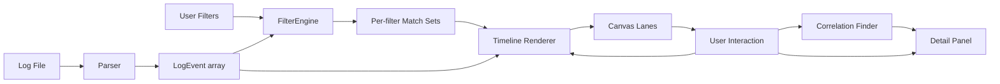

# logGraph — Perfetto-style Log Timeline Analyzer

## Goal
A web-based log analyzer that lets you define **multiple regex/keyword filters**, then visualize each filter's matches as a **stacked timeline lane** (track) on a shared time axis — like Perfetto/SmartPerf. The value: **time-based correlation between search results** is immediately visible by vertical alignment of events across lanes, instead of manually jumping between timestamps in Notepad++.

## Confirmed Requirements
- **Stack**: Web app (HTML5 + Canvas), runs in browser, Electron-wrapped optional
- **Log format**: Single leading timestamp per line, e.g. `2024-01-01 12:00:00.123 [Thread1] LEVEL msg`
- **Scale**: Small (< 50 MB, < 100k lines) — load fully into memory, no streaming needed
- **Visualization**: Stacked lanes — one lane per filter, events placed at their timestamps

## Technology Decisions
| Concern | Choice | Rationale |
|---|---|---|
| Build | Vite + TypeScript | Fast dev server, type safety |
| UI chrome | React | Composable panels (filters, detail, toolbar) |
| Timeline | Custom HTML5 Canvas 2D | Perfetto-like perf, full control over lanes/cursor/linking |
| State | Zustand (lightweight) | Avoid prop-drilling across canvas + panels |
| Styling | CSS Modules | Simple, scoped |
| Desktop | Electron (optional) | Same web code, file-system access |

## Data Model
```ts
interface LogEvent {
  id: number;          // line index
  ts: number;          // epoch ms, parsed from line head
  raw: string;         // full original line
  thread?: string;     // [Thread1] if present
  level?: string;      // INFO/WARN/...
  message: string;     // rest of line after header
}

interface Filter {
  id: string;
  label: string;
  color: string;
  pattern: string;     // user-typed search string or regex
  isRegex: boolean;
  caseSensitive: boolean;
  enabled: boolean;
}

interface FilterMatch {
  filterId: string;
  events: LogEvent[];   // events matching this filter, sorted by ts
}
```

## UI Layout
```
+------------------------------------------------------------+
| Toolbar: [Open] log:84,231 lines  range 09:00:00->09:05:00 |
+----------+-------------------------------------------------+
| Filters  |  Timeline (Canvas)                              |
| Sidebar  |  +-------------------------------------------+   |
|          |  | Time ruler / axis ticks                   |   |
| [+ Add]  |  +-------------------------------------------+   |
| F1 ●    |  | Lane F1:   |  ▌▌   ▌   ▌▌▌                |   |
| F2 ●    |  | Lane F2:   |     ▌  ▌▌                    |   |
| F3 ●    |  | Lane F3:   | ▌▌     ▌▌▌▌                  |   |
|          |  +-------------------------------------------+   |
|          |  | Minimap / overview                        |   |
|          |  +-------------------------------------------+   |
|          |-------------------------------------------------|
|          | Detail Panel: selected event full line + ctx    |
+----------+-------------------------------------------------+
```

## Correlation Features (core value)
1. **Shared time axis** — vertical alignment across lanes = temporal correlation at a glance.
2. **Time scrubber** — a draggable vertical cursor spanning all lanes; each lane shows a tooltip of its nearest event to the cursor.
3. **Click-to-correlate** — clicking an event in lane A highlights temporally-proximate events in all other lanes (window = configurable, default zoom-adaptive) and draws optional linking curves.
4. **Range brush** — drag-select a time region to zoom and to filter the detail panel to that window.
5. **Detail panel with context** — selected event's full raw line plus N surrounding lines (configurable), so you keep log-reading continuity.

## Architecture / Data Flow


## Module Layout
```
src/
  main.tsx                  # React entry
  App.tsx                   # layout shell
  store/logStore.ts         # Zustand: events, filters, selection, view-range
  parser/
    LogParser.ts            # raw text -> LogEvent[], ts auto-detect
    timestampFormats.ts     # common ts regex presets
  filters/
    types.ts                # Filter, FilterMatch
    FilterEngine.ts         # match events to filters
  io/
    fileLoader.ts           # FileReader + drag-drop
  timeline/
    TimelineCanvas.tsx      # canvas host + RAF render loop
    renderers/
      axis.ts               # time ruler ticks
      lane.ts               # per-filter lane + event marks
      minimap.ts            # overview strip
    interaction.ts          # wheel-zoom, drag-pan, brush, hover
    correlation.ts          # find temporal neighbors across lanes
  components/
    Toolbar.tsx
    FiltersSidebar.tsx
    FilterEditor.tsx
    DetailPanel.tsx
    Minimap.tsx
  styles/
```

## Implementation Todo (see todo list)
Scaffold -> UI shell -> file loading -> parser -> filter model + engine -> timeline canvas (axis+lanes) -> zoom/pan/brush -> hover/click -> correlation -> scrubber -> detail panel -> minimap -> polish -> (optional) Electron.

## Open Questions for Review
1. Framework: React recommended — acceptable, or prefer Vue/vanilla?
2. Correlation window default: zoom-adaptive (e.g. ~2% of visible range) vs fixed (±100ms)?
3. Should lanes also support grouping by a secondary field (thread/component) within a filter, or one flat lane per filter is enough for v1?
4. Do you want persistence of filters (localStorage) across sessions?
