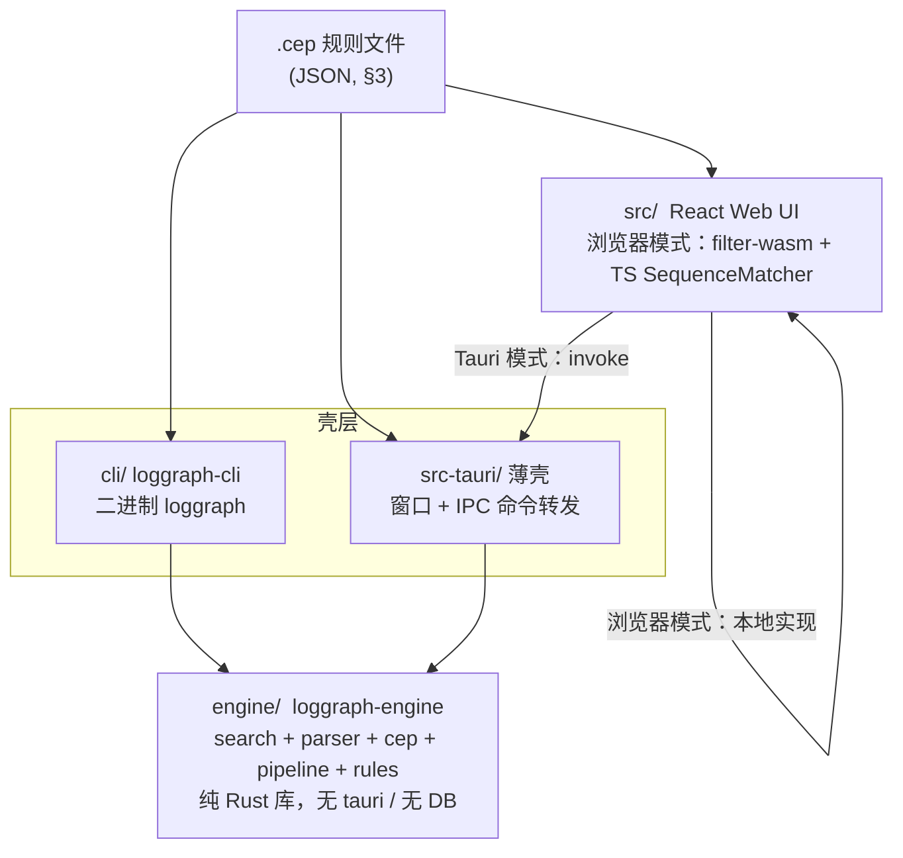

# logGraph 引擎 / CLI / Tauri / Web 接口契约（v1.2 = v1.1 + §11 附录，已确认）

> 目的：冻结四层架构下引擎 Rust API、CLI 命令面、
>
> `.cep`
>
>  规则文件 schema、
> JSON 输出 schema、Tauri IPC 命令面与能力边界。
> 代码以本文件为准（v1.1 已确认，D1–D11 见 §10 决议记录）；与原型的差异见 §9。
> 原则：
>
> **零数据库依赖**
>
> （无 SQLite），全程流式扫描，内存中只保留命中行。
> **单一事实源**
>
> ：
>
> `.cep`
>
>  规则文件是四层共享的规则载体；引擎结果 DTO 是
> Tauri / Web / CLI 共享的结果载体（字段名两端一致）。
> **Agent 优先**
>
> ：一切机器可读输出走 
>
> `--json`
>
> ，结构稳定、键序确定、
> 错误带稳定 code；人类输出只是 JSON 的另一种渲染。
> 基础、稳定、实用；第一版宁缺毋滥，不支持的能力
>
> **显式 fallback**
>
> ，不静默。


***

## 0. 总则

### 0.1 术语


| 术语               | 含义                                                   |
| ---------------- | ---------------------------------------------------- |
| filter           | 一条命名搜索模式（关键词或正则），产生一个事件流                             |
| group            | 一组 filter 引用 + 边集合，构成一个序列匹配单元                        |
| edge             | group 内两个 filter 间的时序约束（seq/not/and/or/opt/periodic） |
| 链 /chain         | 一次完整匹配：按边推进、逐步消耗事件得到的 Step 序列                        |
| 事件 /event        | 一条带 epoch ms 时间戳的命中行（`SeqEvent`）                     |
| 未覆盖事件 /uncovered | 命中但未被任何链消耗的事件（anomaly 候选）                            |
| 规则文件 / `.cep` 文件 | 本契约 §3 约束的 JSON 文档，`loggraph cep -R` 的输入             |

### 0.2 稳定性承诺


* **Stable**：本文件标 ✅ 的语义在 v1.x 内冻结（含 JSON 字段名与错误 code）。

* **Experimental**：标 ⚠️ 的语义可在 minor 版本调整，调整前会在 changelog 标注。

* v1 不支持的特性（§8）在文件中**允许出现**，引擎按 §3.9 给出警告并 fallback，

  这样规则文件可以先于引擎能力写好（前向兼容靠 `version` 字段，§3.2）。

### 0.3 命名与编码规范


* JSON 字段命名一律 **camelCase**。唯一例外：`line_number` 保持 snake\_case

  （对齐 `rg --json` 先例，见决策点 D4）。

* 时间戳一律 **epoch 毫秒**（JSON number，i64）；人类可读时间串只出现在

  文本输出（§4.7）与 UI，不出现在任何 JSON 契约里。

* 行号 1-based；`Infinity` 不出现在 JSON（`nodeCounts.max` 缺省即无上界）。

* 字符串编码：文件按 UTF-8 读（容忍并剥离 BOM）；命中行若含无效 UTF-8，

  替换为 U+FFFD 后输出。CLI stdout/stderr 一律 UTF-8

  （Windows 旧控制台乱码属终端问题，二进制不做转码）。

* 未知字段一律**拒绝**（serde `deny_unknown_fields` + schema

  `additionalProperties: false`）：拼错字段名必须报错，不允许静默取默认值。


***

## 1. 分层架构

### 1.1 布局与依赖方向




规则（强制）：


* 依赖方向单向：`cli → engine`、`src-tauri → engine`、`src → src-tauri`(IPC)。

  **engine 不反向依赖任何壳**，不依赖 tauri /rusqlite/ 任何 UI 类型。

* engine 可独立 `cargo test`、可被 WASM 侧或任意前端以 FFI 嵌入。

* 壳层只做三件事：参数解析 / 进程边界（IPC、退出码）/ 输出格式化。

  **业务语义（含规则校验）全部在 engine**，CLI 与 Tauri 不各自实现一份。

### 1.2 各层职责边界


| 层       | crate / 目录                 | 职责                              | 禁止                       |
| ------- | -------------------------- | ------------------------------- | ------------------------ |
| 引擎      | `engine/`（loggraph-engine） | 搜索、遍历、时间戳、CEP 匹配、规则装载与校验        | 依赖 tauri / DB；打印到 stdout |
| CLI     | `cli/`（loggraph）           | clap 参数、退出码映射、文本 / JSON 渲染      | 实现任何匹配语义                 |
| Tauri 壳 | `src-tauri/`               | 窗口、IPC 命令、engine 错误 → 可序列化 DTO  | 实现任何匹配语义                 |
| Web     | `src/`                     | React UI；桌面模式走 IPC，浏览器模式走 TS 实现 | 直接链 Rust（除 wasm 包）       |

### 1.3 Web 双模式

同一份 React 代码跑两种后端：


* **Tauri 模式（桌面）**：`invoke('engine_*')` → engine，能力全集。

* **浏览器模式**：`filter-wasm`（regex 过滤）+ `src/sequence/SequenceMatcher.ts`

  （TS 版序列匹配）。TS 实现是浏览器**降级路径**，语义上允许落后于引擎，

  但**结果 DTO 字段必须与 §5.2 一致**（同为 `SequenceMatchResult` 形状）。

模式探测：`window.__TAURI__` 存在 → Tauri 模式。UI 不感知差异的接口

（如 `.cep` 文件导入导出）两端行为一致。

### 1.4 共享契约面（四层都依赖的东西）


| 契约                  | 定义处         | 消费方                                              |
| ------------------- | ----------- | ------------------------------------------------ |
| `.cep` 规则文件 schema  | §3          | CLI `-R`、Tauri `engine_run_cep`、UI 导入导出、外部 agent |
| 规则校验错误对象            | §3.10       | CLI `validate`、Tauri、UI 表单校验                     |
| 结果 DTO（SeqResult 等） | §2.4 / §5.2 | CLI `--json`、Tauri IPC 返回、UI store、TS matcher    |
| 时间戳格式 id 集          | §2.3        | parser 双实现（Rust/TS）对齐                            |


***

## 2. Rust 引擎 API（loggraph-engine）

### 2.1 错误模型（统一替代当前的 `String` 错误）


```rust
#[derive(Debug, thiserror::Error, Serialize, Clone)]
#[serde(rename_all = "snake_case")]
pub enum EngineError {
    #[error("非法正则/模式 {input:?}: {source}")]
    InvalidPattern { input: String, source: grep_regex::Error },

    #[error("非法 glob {glob:?}: {source}")]
    InvalidGlob { glob: String, source: ignore::Error },

    #[error("读取/扫描 {path} 失败: {source}")]
    Io { path: PathBuf, source: std::io::Error },

    #[error("规则文件 JSON 语法错误: {0}")]
    RulesSyntax(serde_json::Error),          // E_RULES_SYNTAX

    #[error("规则文件不符合 schema: {issues:?}")]
    RulesSchema { issues: Vec<RuleIssue> },  // E_RULES_SCHEMA（聚合）

    #[error("规则文件语义错误: {issues:?}")]
    RulesSemantic { issues: Vec<RuleIssue> },// E_RULES_SEMANTIC（聚合）

    #[error("不支持的规则文件版本: {found}, 引擎支持 {supported:?}")]
    RulesVersion { found: u32, supported: Vec<u32> }, // E_RULES_VERSION

    #[error("{path} 下未找到可搜索文件")]
    NoFiles { path: PathBuf },               // E_NO_FILES
}
pub type EngineResult<T> = Result<T, EngineError>;
```


* 所有公开函数返回 `EngineResult<T>`；`thiserror` 仅 derive，不增运行时负担。

* **序列化形状（Tauri / `--json` 错误输出共用）**：

  `{ "code": "E_PATTERN", "message": "非法正则…", "details": {…可选} }`，

  `code` 取值见 §3.10 错误码表；CLI 层打印 message 后映射退出码（§4.6）。

* 引擎内部 panic 一律视为 bug（E\_INTERNAL 由壳层兜底捕获，不进契约）。

### 2.2 search 模块（rg 直扫 + 目录遍历）


```rust
pub struct Pattern {
    pub pattern: String,
    pub case_sensitive: bool,   // false = -i
    pub is_regex: bool,         // false = 字面量（元字符自动转义）
}
impl Pattern {
    pub fn literal(s: impl Into<String>) -> Self;   // case_sensitive = true
    pub fn regex(s: impl Into<String>) -> Self;
    pub fn case_insensitive(self) -> Self;
    pub fn compile(&self) -> EngineResult<RegexMatcher>;
}

pub struct Hit       { pub line_number: u64, pub text: String } // 1-based，去行尾
pub struct FileHits  { pub path: PathBuf, pub hits: Vec<Hit> }  // 文件内按行号升序
pub struct SearchStats {
    pub files_searched: usize,
    pub files_with_matches: usize,
    pub matched_lines: u64,
    pub elapsed_ms: u128,
}

pub struct WalkOptions {
    pub hidden: bool,          // --hidden；默认跳过隐藏
    pub no_ignore: bool,       // --no-ignore
    pub globs: Vec<String>,    // -g，! 前缀排除
    pub exts: Vec<String>,     // 扩展名白名单；空 = 不限制
}
impl Default for WalkOptions;   // 全 false / 空

pub fn walk(root: &Path, opts: &WalkOptions) -> EngineResult<Vec<PathBuf>>;
pub fn search_file(path: &Path, pat: &Pattern) -> EngineResult<FileHits>;
pub fn search_all(paths: &[PathBuf], pat: &Pattern)
    -> EngineResult<(Vec<FileHits>, SearchStats)>;
```

语义约定（✅ Stable）：


* `walk`：`root` 为文件 → `vec![root]`；目录 → 递归，尊重

  `.gitignore` / `.ignore` / `.rgignore` / 全局 gitignore /

  `$GIT_DIR/info/exclude`，默认跳过隐藏。返回路径 = `root` 拼接后的路径

  （`root` 写相对则相对、写绝对则绝对）。同一目录快照下顺序确定，

  但**不承诺排序规则**（需要排序的消费方自行排）。

* `search_all`：按文件并行（`thread::scope`），**输出顺序与输入 `paths` 一致**，

  文件内按行号升序。

* 默认 Unicode 行模式；命中二进制（行内 NUL）该文件即停（rg 默认行为）。

* CRLF：按 LF 切行，`text` 统一去掉尾部 `\r`。

* 字面量对 regex 元字符自动转义（`\ . + * ? ( ) | [ ] { } ^ $`）。

### 2.3 parser 模块（时间戳探测 / 提取）


```rust
pub struct TsFormat { pub id: &'static str }   // 见下 5 种
pub struct ExtractedTimestamp {
    pub ts: i64,            // epoch ms
    pub start: usize,       // 匹配字节区间（0-based，行内）
    pub end: usize,
    pub format_id: &'static str,
}

pub fn formats() -> &'static [TsFormat];
pub fn find_format(id: &str) -> Option<&'static TsFormat>;
pub fn detect_timestamp_format(sample: &[&str]) -> Option<&'static TsFormat>;
pub fn extract_timestamp(line: &str, fmt: Option<&TsFormat>)
    -> Option<ExtractedTimestamp>;
// fmt=None → 按优先级逐格式尝试；某格式命中但 parse 失败则继续下一个。
```

格式与优先级（顺序即优先级，**勿调整**；TS 侧 `timestampFormats.ts` 必须同表）：


| # | id             | 形态                                 | 说明                  |
| - | -------------- | ---------------------------------- | ------------------- |
| 1 | `iso-local-ms` | `2024-01-01 12:00:00.123`          | 无时区，按本地墙钟直接解释       |
| 2 | `iso-8601`     | `2024-01-01T12:00:00+08:00` / `…Z` | 带偏移，换算 UTC          |
| 3 | `syslog`       | `Jan 02 12:00:00`                  | 无年份 → 取**当前年**      |
| 4 | `time-only-ms` | `12:00:00.123`                     | 日期锚定 **1970-01-01** |
| 5 | `epoch`        | `1704067200123` / `1704067200`     | 13 位 ms / 10 位 s    |

探测算法（✅ Stable）：能 regex 匹配最多行的格式获胜，**严格大于**才替换

（平局保留在前者）。`run_cep` 用前 200 条命中行做一次探测；探测格式

parse 失败的行，逐行回退全格式尝试（§2.5）。

### 2.4 cep 模块（序列匹配纯算法）


```rust
// 请求 DTO（camelCase 反序列化，deny_unknown_fields）
pub struct GroupSpec {
    pub group_id: String,
    pub filter_ids: Vec<String>,
    pub scope: String,                       // "global" | "thread"
    pub edges: Vec<EdgeSpec>,
    pub node_conditions: Option<HashMap<String, String>>,
    pub node_counts: Option<HashMap<String, NodeCountSpec>>,
}
pub struct EdgeSpec {
    pub id: String,
    pub from_filter_id: String,
    pub to_filter_id: Option<String>,        // §3.5：and/or 时不提供
    pub to_filter_ids: Option<Vec<String>>,  // and/or 多目标
    pub kind: Option<String>,                // seq|not|and|or|opt|periodic；缺省 seq
    pub max_gap_ms: i64,
    pub period_ms: Option<i64>,              // 仅 periodic
}
pub struct NodeCountSpec { pub min: Option<i64>, pub max: Option<i64> }

// 事件（输入/输出共用）
pub struct SeqEvent {
    pub id: u32,                 // 全局唯一物理行身份（见 §2.5 分配规则）
    pub ts: i64,                 // epoch ms
    pub raw: String,
    pub message: String,
    pub thread: Option<String>,
}

// 结果 DTO（camelCase 序列化；字段见 §5.2 JSON 示例）
pub struct Step        { pub edge_id: Option<String>, pub filter_id: String, pub event: SeqEvent }
pub struct MatchedChain{ pub chain_index: u32, pub steps: Vec<Step>,
                         pub start_ts: i64, pub end_ts: i64, pub thread: Option<String> }
pub struct EdgeStat    { pub edge_id: String, pub matched_count: u32, pub miss_count: u32,
                         pub late_count: Option<u32>, pub jitter_count: Option<u32> }
pub struct NotViolation{ pub edge_id: String, pub from_event: SeqEvent, pub to_event: SeqEvent }
pub struct Heartbeat   { /* periodic 用，v1 恒空数组 */ }
pub struct SeqResult {
    pub group_id: String,
    pub chains: Vec<MatchedChain>,
    pub uncovered_events: Vec<SeqEvent>,
    pub edge_stats: Vec<EdgeStat>,
    pub not_violations: Vec<NotViolation>,
    pub heartbeats: Vec<Heartbeat>,
}
pub struct RunSeqResponse { pub fallback: bool, pub results: BTreeMap<String, SeqResult> }
// BTreeMap：--json 输出按 groupId 字典序，agent 可依赖键序

pub type EventStore = HashMap<String, Vec<SeqEvent>>; // filter_id → 按 (ts,id) 升序

impl GroupSpec { pub fn is_supported(&self) -> bool }
pub fn match_group(spec: &GroupSpec, store: &EventStore) -> EngineResult<SeqResult>;
pub fn run_sequences(groups: &[GroupSpec], store: &EventStore) -> RunSeqResponse;
```

语义（✅ Stable，忠实现有实现）：


* **NOT 边**为纯断言、不消耗事件：对每个 from 事件检查窗口

  `(tsFrom, tsFrom + maxGapMs]` 内是否出现 to 事件，出现即记一条

  `NotViolation`，`missCount` +1。

* **推进边**（seq/and/or）解析为推进链（拓扑 + DFS 枚举；环从各节点各试一次）。

  窗口内多目标就绪时取 **ts 最早**；ts 相同按 **filterId 字典序**。

  and/or 边的链延续锚点 = `toFilterIds[0]`（与 UI 惯例一致）。

* 同一物理行被多过滤器命中时，CEP 内为**同一 `id`（消耗互相可见）**。

* 链产出后按 `(startTs, endTs)` 排序，`chainIndex` 排序后 **1-based** 重编号。

* `uncoveredEvents` = group 的 filterIds 中未被任何链消耗的事件，按 `(ts, id)` 升序。

* `is_supported() = false` 的 group 不计算；任一 group 不支持 → 整个

  `RunSeqResponse.fallback = true`（§3.9 W 码）。

### 2.5 pipeline 模块（无数据库一条龙）


```rust
pub struct FilterDef {
    pub id: String,
    pub pattern: String,
    pub case_sensitive: bool,   // serde 缺省 false（与 UI 默认一致）
    pub is_regex: bool,         // serde 缺省 false
}
pub struct PipelineStats {
    pub files: usize,
    pub filter_hits: HashMap<String, u64>,   // 每过滤器命中行数
    pub events_with_ts: u64,                 // 进入 CEP 的事件数
    pub ts_format: Option<String>,           // 探测结果；None = 全失败
    pub no_ts: u64,                          // 命中但无时间戳、被丢弃
}
pub fn run_cep(
    paths: &[PathBuf],
    filters: &[FilterDef],
    groups: &[GroupSpec],
) -> EngineResult<(RunSeqResponse, PipelineStats)>;
```

流程（✅ Stable）：


1. 每过滤器一次 `search_all`（同一份 `paths`）。

2. 用前 200 条命中行探测一次 ts 格式（§2.3）。

3. 事件 `id` 分配：key = `(文件在 paths 中的下标, 1-based 行号)` → 全局自增

   `u32`（从 1 起）；同一物理行多过滤器命中共用同一 id。ts 提取：先按探测

   格式，失败逐行回退全格式；仍失败计入 `noTs` 并丢弃（不进 CEP）。

4. `run_sequences`。

### 2.6 rules 模块（规则文件装载与校验）

规则文件的**完整契约见 §3**（本节只定 API 形状）。校验分三层，全部在引擎：


```rust
pub struct RulesFile {
    pub version: u32,             // 当前恒 1
    pub filters: Vec<FilterDef>,
    pub groups: Vec<GroupSpec>,
}

pub struct RuleIssue {
    pub code: IssueCode,          // E_RULES_SCHEMA | E_RULES_SEMANTIC | W_*
    pub rule: Option<&'static str>, // "S04" 等，见 §3.8/§3.9
    pub path: String,             // "$.groups[0].edges[1].toFilterId"
    pub message: String,          // 人类可读，含具体值
}

pub struct RuleReport { pub errors: Vec<RuleIssue>, pub warnings: Vec<RuleIssue> }

/// 只校验不构造：聚合返回全部问题（不 fail-fast），供 validate 命令 / UI 表单用
pub fn validate_rules(json: &str) -> RuleReport;

/// 校验 + 构造：任一 error → Err(RulesSchema / RulesSemantic / RulesVersion)
pub fn parse_rules(json: &str) -> EngineResult<RulesFile>;
```


* 三层校验顺序：JSON 语法（`E_RULES_SYNTAX`）→ 结构（schema，`E_RULES_SCHEMA`）

  → 语义（`E_RULES_SEMANTIC`，S 码）。语法错误时后两层不执行。

* `parse_rules` 供 `run_cep` 调用方使用；CLI 的 `-R` 路径必须先过它。

***

## 3. `.cep` 规则文件契约（★ 本版核心补充）

### 3.1 文件身份

| 项 | 约定 |
| --- | --- |
| 扩展名 | 推荐 `.cep.json`（双扩展名，编辑器自动按 JSON 处理）；`.cep`、`.json` 也接受。引擎**不按扩展名拒绝**，按内容解析（D8） |
| 编码 | UTF-8，无 BOM（带 BOM 引擎剥离） |
| 内容 | 单个 JSON 文档（非 NDJSON、无注释） |
| 用途 | `loggraph cep -R`、Tauri `engine_run_cep`、UI 导入导出、agent 生成 |
| 定位 | **规则载体，不是 UI 工程文件**：只含计算所需字段 + 少量展示元数据（`label`/`description`，引擎忽略）。颜色 / 折叠 / 视图状态归 UI 自己的工程文件 |

### 3.2 顶层结构

```json
{
  "$schema": "https://loggraph.dev/schemas/cep-rules-1.schema.json",
  "version": 1,
  "description": "启动阶段健康检查规则（可选，引擎忽略）",
  "filters": [ { "id": "…", "pattern": "…" } ],
  "groups":   [ { "groupId": "…", "filterIds": ["…"], "edges": [] } ]
}
```

| 字段 | 类型 | 必填 | 缺省 | 说明 |
| --- | --- | --- | --- | --- |
| `$schema` | string(uri) | 否 | — | 指向 §3.7 schema；写入后编辑器获得补全 / 校验，引擎不校验其值 |
| `version` | integer | 否 | `1` | 规则文件格式版本。引擎遇到不支持的版本报 `E_RULES_VERSION`（S11），**不猜测降级** |
| `description` | string ≤2000 | 否 | — | 人类备注，引擎忽略 |
| `filters` | array | **是** | — | 1..1024 条 |
| `groups` | array | 否 | `[]` | 0..1024 条。空 groups = 纯多模式扫描（只要 stats 与每过滤器命中数） |

### 3.3 `filters[]`（过滤器定义）

| 字段 | 类型 | 必填 | 缺省 | 约束 / 说明 |
| --- | --- | --- | --- | --- |
| `id` | string | **是** | — | `^[A-Za-z0-9_][A-Za-z0-9_.-]{0,63}$`，全局唯一（S01） |
| `label` | string ≤64 | 否 | — | 展示名（UI 元数据，引擎忽略） |
| `pattern` | string | **是** | — | 1..4096 字符；非空（空模式匹配一切，属脚枪） |
| `isRegex` | boolean | 否 | `false` | `false` = 字面量，元字符自动转义（§2.2） |
| `caseSensitive` | boolean | 否 | `false` | 缺省不区分大小写（与 UI Filter 默认一致；注意与 rg 相反，CLI 的 `-i` 是反向开关） |
| — | — | — | — | **无 `scope` 字段**：引擎按整行 raw 匹配；UI 的 `scope:"message"` 过滤器导出时必须提示（§3.12） |

`isRegex: true` 时 `pattern` 必须能被 Rust `regex` crate 编译（S08），
失败报 `E_PATTERN` 系错误并指到 `$.filters[i].pattern`。

### 3.4 `groups[]`（序列匹配单元）

| 字段 | 类型 | 必填 | 缺省 | 约束 / 说明 |
| --- | --- | --- | --- | --- |
| `groupId` | string | **是** | — | id 格式同上，全局唯一（S02） |
| `label` | string ≤64 | 否 | — | 展示名，引擎忽略 |
| `scope` | enum | 否 | `"global"` | `global` \| `thread`。`thread` = 按 `thread` 字段分桶隔离匹配（v1 不支持 → W01） |
| `filterIds` | string[] | **是** | — | 1..256 项，去重；每项 ∈ `filters[].id`（S03）。**边只能引用这里声明的 filter**（S04） |
| `edges` | Edge[] | **是** | — | 0..256 条；可为空（该 group 只产出 uncovered 事件清单） |
| `nodeCounts` | map | 否 | `{}` | 见 §3.6（v1 不支持 → W04） |
| `nodeConditions` | map | 否 | `{}` | 见 §3.6（v1 不支持 → W05） |

### 3.5 `groups[].edges[]`（边定义与 kind 语义）

| 字段 | 类型 | 必填 | 缺省 | 约束 / 说明 |
| --- | --- | --- | --- | --- |
| `id` | string | **是** | — | id 格式同上，**跨 group 全局唯一**（S05） |
| `kind` | enum | 否 | `"seq"` | `seq` \| `not` \| `and` \| `or` \| `opt` \| `periodic` |
| `fromFilterId` | string | **是** | — | ∈ 所在 group 的 `filterIds`（S04） |
| `toFilterId` | string | 条件 | — | seq/not/opt/periodic **必填**；and/or **禁止**（S06） |
| `toFilterIds` | string[] | 条件 | — | and/or **必填**（2..16 项去重）；其余 kind **禁止**（S06） |
| `maxGapMs` | integer | **是** | — | ≥ 0。窗口语义 `(tsFrom, tsFrom + maxGapMs]`；`0` = 空窗口（seq 永不命中 /not 恒通过），合法但不推荐 |
| `periodMs` | integer | 条件 | — | 仅 periodic **必填**（>0）；其余 kind **禁止**（S07） |

kind 语义表（✅ 与 §2.4 实现一一对应）：

| kind | EPL 类比 | 语义 | v1 |
| --- | --- | --- | --- |
| `seq` | `A -> B within W` | 窗口 W 内出现最早就绪的 B 即推进；窗口耗尽 / 另一 A 插队 → 断裂 | ✅ |
| `not` | `A -> not B within W` | 纯断言不消耗：W 内出现 B → 记 `NotViolation` | ✅ |
| `and` | `A -> B and C within W` | 窗口内 B、C **都**出现才推进（各自消耗） | ✅ |
| `or` | `A -> (B or C) within W` | 窗口内任一出现即推进（取最早就绪者） | ✅ |
| `opt` | `A -> B? -> C` | B 可缺省：链可直接跳过（有 B 用 B，贪心长路径） | ❌ W02 |
| `periodic` | `every A where timer:within(P±δ)` | 期望周期 P 的心跳断言：间隔 ∈ [P−δ, P+δ] 为正常 | ❌ W03 |

### 3.6 `nodeCounts` / `nodeConditions`（节点级约束，v1 保留字段）

```json
{
  "groupId": "startup",
  "filterIds": ["A", "B", "C"],
  "edges": [],
  "nodeCounts":     { "B": { "min": 2, "max": 5 }, "C": { "min": 3 } },
  "nodeConditions": { "B": "level == 'E' && msg.includes('IPC')" }
}
```

* `nodeCounts`：filterId → `{ min?, max? }`，整型 ≥1，至少给一个端；
  缺省端 = `min:1` / `max:∞`；须 `min ≤ max`（S10）。语义 = EPL `A{2,5}`
  （该 filter 在链中此步重复出现 N 次）。
* `nodeConditions`：filterId → 表达式串（1..512 字符），对 filter 匹配事件
  二次过滤；表达式语法子集见 `plans/epl-cep-spec.md` P2-B（TS 侧
  `src/sequence/expr.ts` 为参照实现）。
* 两者的键 ∈ 所在 group 的 `filterIds`（S09）。
* **v1 引擎不支持**（W04/W05）：文件里允许写（前向兼容），该 group 不计算、
  `fallback = true`，`validate` 报警告不报错误。

### 3.7 完整 JSON Schema（draft 2020-12）

> 实现时原样落盘为 `schemas/cep-rules-1.schema.json` 并 `include_str!` 进
> engine（`loggraph schema` 命令输出同一份，保证三者不漂移）。
> 引擎侧校验以 §3.8 S 码为准，schema 是编辑器 / 外部工具的第一道防线。

```json
{
  "$schema": "https://json-schema.org/draft/2020-12/schema",
  "$id": "https://loggraph.dev/schemas/cep-rules-1.schema.json",
  "title": "logGraph CEP rules file (version 1)",
  "description": "约束 loggraph cep -R 规则文件。引用完整性等语义校验由引擎额外执行（契约 §3.8）。",
  "type": "object",
  "additionalProperties": false,
  "required": ["filters"],
  "properties": {
    "$schema":    { "type": "string", "format": "uri" },
    "version":    { "type": "integer", "const": 1, "default": 1 },
    "description":{ "type": "string", "maxLength": 2000 },
    "filters": {
      "type": "array", "minItems": 1, "maxItems": 1024,
      "items": { "$ref": "#/$defs/filter" }
    },
    "groups": {
      "type": "array", "maxItems": 1024, "default": [],
      "items": { "$ref": "#/$defs/group" }
    }
  },
  "$defs": {
    "id": {
      "type": "string",
      "pattern": "^[A-Za-z0-9_][A-Za-z0-9_.-]{0,63}$"
    },
    "filter": {
      "type": "object",
      "additionalProperties": false,
      "required": ["id", "pattern"],
      "properties": {
        "id":           { "$ref": "#/$defs/id" },
        "label":        { "type": "string", "maxLength": 64 },
        "pattern":      { "type": "string", "minLength": 1, "maxLength": 4096 },
        "isRegex":      { "type": "boolean", "default": false },
        "caseSensitive":{ "type": "boolean", "default": false }
      }
    },
    "group": {
      "type": "object",
      "additionalProperties": false,
      "required": ["groupId", "filterIds", "edges"],
      "properties": {
        "groupId":   { "$ref": "#/$defs/id" },
        "label":     { "type": "string", "maxLength": 64 },
        "scope":     { "enum": ["global", "thread"], "default": "global" },
        "filterIds": {
          "type": "array", "minItems": 1, "maxItems": 256,
          "uniqueItems": true,
          "items": { "$ref": "#/$defs/id" }
        },
        "edges": {
          "type": "array", "maxItems": 256,
          "items": { "$ref": "#/$defs/edge" }
        },
        "nodeCounts": {
          "type": "object", "maxProperties": 256,
          "propertyNames": { "$ref": "#/$defs/id" },
          "additionalProperties": { "$ref": "#/$defs/nodeCount" }
        },
        "nodeConditions": {
          "type": "object", "maxProperties": 256,
          "propertyNames": { "$ref": "#/$defs/id" },
          "additionalProperties": { "$ref": "#/$defs/expr" }
        }
      }
    },
    "edge": {
      "type": "object",
      "additionalProperties": false,
      "required": ["id", "fromFilterId", "maxGapMs"],
      "properties": {
        "id":           { "$ref": "#/$defs/id" },
        "kind":         { "enum": ["seq", "not", "and", "or", "opt", "periodic"],
                          "default": "seq" },
        "fromFilterId": { "$ref": "#/$defs/id" },
        "toFilterId":   { "$ref": "#/$defs/id" },
        "toFilterIds":  {
          "type": "array", "minItems": 2, "maxItems": 16,
          "uniqueItems": true,
          "items": { "$ref": "#/$defs/id" }
        },
        "maxGapMs":     { "type": "integer", "minimum": 0 },
        "periodMs":     { "type": "integer", "exclusiveMinimum": 0 }
      },
      "allOf": [
        { "if": { "required": ["kind"],
                  "properties": { "kind": { "enum": ["and", "or"] } } },
          "then": { "required": ["toFilterIds"],
                    "not": { "required": ["toFilterId"] } } },
        { "if": { "properties": { "kind":
                    { "enum": ["seq", "not", "opt", "periodic"] } } },
          "then": { "required": ["toFilterId"],
                    "not": { "required": ["toFilterIds"] } } },
        { "if": { "required": ["kind"],
                  "properties": { "kind": { "const": "periodic" } } },
          "then": { "required": ["periodMs"] } },
        { "if": { "properties": { "kind":
                    { "enum": ["seq", "not", "and", "or", "opt"] } } },
          "then": { "not": { "required": ["periodMs"] } } }
      ]
    },
    "nodeCount": {
      "type": "object",
      "additionalProperties": false,
      "properties": {
        "min": { "type": "integer", "minimum": 1 },
        "max": { "type": "integer", "minimum": 1 }
      },
      "anyOf": [ { "required": ["min"] }, { "required": ["max"] } ]
    },
    "expr": { "type": "string", "minLength": 1, "maxLength": 512 }
  }
}
```

（`if` 条件的空缺省语义已核对：`kind` 缺省按 `seq` 走第二 / 四分支。）

***

## 3.8 语义校验规则（S 码，引擎侧强制）

> 输出形状见 §3.10；`path` 定位到最小 JSON 节点。同一问题只报一次、
> 不重复报。下表 "层"= 校验所属层：结构层（schema 镜像）/ 语义层（typed）。

| 码 | 层 | 规则 | 失败示例 |
| --- | -- | --- | --- |
| S01 | 语义 | `filters[].id` 全局唯一 | 两个 filter 都叫 `error` |
| S02 | 语义 | `groups[].groupId` 全局唯一 | 两个 group 都叫 `startup` |
| S03 | 语义 | `groups[].filterIds[]` ⊆ 已声明 filter | filterIds 引用了不存在的 `X` |
| S04 | 语义 | 边端点（from + to）∈ 所在 group 的 filterIds | 边引用了 group 外的 filter |
| S05 | 语义 | `edges[].id` **跨 group** 全局唯一 | 两个 group 里都有 `e1` |
| S06 | 语义 | kind ↔ 目标字段匹配（§3.5 表） | `and` 边只给了 `toFilterId` |
| S07 | 语义 | `periodic` ↔ `periodMs` 匹配（§3.5 表） | `seq` 边带 `periodMs` |
| S08 | 语义 | `isRegex:true` 的 pattern 可编译 | `([unclosed` |
| S09 | 语义 | `nodeCounts`/`nodeConditions` 键 ∈ 所在 group 的 filterIds | 键 `Z` 不在 filterIds |
| S10 | 语义 | nodeCount `1 ≤ min ≤ max`（缺省端 min=1 /max=∞） | `{ "min": 5, "max": 2 }` |
| S11 | 版本 | `version` ∈ 引擎支持集（当前 `{1}`）；非整数 → schema 层 | `"version": 2` |

校验顺序与聚合（✅ Stable）：

1. **语法层**（E_RULES_SYNTAX）：JSON 解析失败即终止，一条 issue。
2. **版本闸门**（S11）：解析成功后立即检查 `version`。缺省 = 1。
   不支持的版本**立即终止**（后面的结构校验对未知版本没有意义），
   报 `E_RULES_VERSION`。非整数类型（如 `"1"`、`1.5`）归 schema 层。
3. **结构层**（E_RULES_SCHEMA）：镜像 §3.7 schema 的手写校验
   （未知字段 / 必填 / 类型 / 枚举 / id 正则 / 边界 / 去重），**聚合全部**
   问题后一次性返回。kind↔字段条件（S06/S07）**不在此层**—— 结构层不懂
   kind 缺省语义，统一在语义层做（schema 里的 `allOf` 是编辑器用的）。
4. **语义层**（E_RULES_SEMANTIC）：typed 反序列化成功后执行 S01–S10，
   聚合全部问题。S08 失败的错误码是 `E_PATTERN`（不是 E_RULES_SEMANTIC），
   但 issue 仍带 `rule: "S08"`。

前层失败 → 后层跳过（语义层跑在干净结构上，报错才有意义）。

### 3.9 警告规则（W 码：v1 不支持 → fallback，永不阻断）

| 码 | 触发 | 处理 |
| --- | --- | --- |
| W01 | `scope: "thread"` | 该 group 不计算（uncovered 空），`fallback=true` |
| W02 | `kind: "opt"` 边 | 同上 |
| W03 | `kind: "periodic"` 边 | 同上 |
| W04 | `nodeCounts` 非空 | 同上 |
| W05 | `nodeConditions` 非空 | 同上 |

* 警告不进 `RuleReport.errors`，不阻断 parse；`cep` 运行时 stderr 提示一次
  并在 `--json` 顶层带 `"fallback": true`。
* 消息模板（示例）：`nodeCounts 引擎 v1 不支持，该 group 将不计算（fallback）`。

### 3.10 RuleIssue 与错误码总表

```json
{ "code": "E_RULES_SCHEMA", "rule": "S04",
  "path": "$.groups[0].edges[1].toFilterId",
  "message": "边端点 \"Z\" 不在 group \"startup\" 的 filterIds 中" }
```

| code | 层 | 场景 | CLI 退出码 |
| --- | -- | --- | --- |
| `E_RULES_SYNTAX` | 语法 | JSON 解析失败 | 2 |
| `E_RULES_VERSION` | 版本 | S11 | 2 |
| `E_RULES_SCHEMA` | 结构 | 未知字段 / 类型 / 枚举 / 边界 | 2 |
| `E_RULES_SEMANTIC` | 语义 | S01–S07、S09、S10 | 2 |
| `E_PATTERN` | 语义 | S08 正则编译失败 | 2 |
| `E_GLOB` | 遍历 | `-g` 非法 glob | 2 |
| `E_IO` | 运行 | 文件读失败、walk io 错误 | 2 |
| `E_NO_FILES` | 遍历 | 路径下无可搜索文件 | 2 |

（`E_NO_FILES` 是否单独成码：单独成码 ——agent 需要区分 "目录空" 与
"权限 / 路径错误"，处理建议不同：前者提示用户换路径，后者直接失败。）

### 3.11 完整示例（合法，含 v1 保留字段）

```json
{
  "$schema": "https://loggraph.dev/schemas/cep-rules-1.schema.json",
  "version": 1,
  "description": "示例：启动链 + 禁止性断言 + v1 保留字段",
  "filters": [
    { "id": "startup", "label": "启动完成", "pattern": "Startup phase complete" },
    { "id": "upstream", "label": "上游恢复", "pattern": "Upstream recovered", "isRegex": false },
    { "id": "reset", "label": "连接重置", "pattern": "reset by peer", "isRegex": true, "caseSensitive": false }
  ],
  "groups": [
    {
      "groupId": "startup_chain",
      "label": "启动健康链",
      "scope": "global",
      "filterIds": ["startup", "upstream", "reset"],
      "edges": [
        { "id": "e1", "kind": "seq", "fromFilterId": "startup",
          "toFilterId": "upstream", "maxGapMs": 20000 },
        { "id": "e2", "kind": "not", "fromFilterId": "startup",
          "toFilterId": "reset", "maxGapMs": 20000 }
      ]
    },
    {
      "groupId": "future_features",
      "filterIds": ["startup", "upstream"],
      "edges": [
        { "id": "e3", "kind": "opt", "fromFilterId": "startup",
          "toFilterId": "upstream", "maxGapMs": 10000 }
      ],
      "nodeCounts":     { "startup": { "min": 1, "max": 3 } },
      "nodeConditions": { "upstream": "level == 'I'" }
    }
  ]
}
```

上面第二个 group 触发 W02 + W04 + W05 三条警告：文件合法可保存、可交换，
引擎 v1 跳过该 group，`fallback=true`。**支持性写法与合法性写法分开**，
这正是 v1 文件能前向迁移到 v2 的原因。

### 3.12 UI 映射（导入导出）

| UI 概念 | `.cep` 字段 | 说明 |
| --- | --- | --- |
| Filter（含 scope/regex/case） | `filters[]` | UI Filter 的 `scope:"message"` 无法表达：**导出时弹窗提示**"该过滤器按整行匹配"（引擎按 raw 匹配，§3.3） |
| Filter name | `label` | 缺省用 `id` |
| Filter 匹配模式 | `pattern` + `isRegex` | literal → `isRegex:false`；regex → `true` |
| Filter 大小写 | `caseSensitive` | UI 默认不敏感 = `.cep` 缺省一致 |
| Group / 头节点 | `groups[]` | UI 拓扑图邻接表展开为 `edges[]` |
| Edge kind | `kind` | UI 创建 and/or 边时只填 `toFilterIds` |
| 节点数量约束（如 3..5） | `nodeCounts` | v1 导入可保留（文件合法），运行时 W04 |
| 表达式条件 | `nodeConditions` | 同上 W05 |
| 颜色 / 折叠 / 视图 | —（不进 `.cep`） | 存 UI 工程文件（如 `.lgui.json`，v1 不定） |

***

## 4. CLI 命令面（`loggraph`，D7）

> clap derive 实现；`--version` 输出语义化版本；所有子命令共用 §4.6 退出码。
> 面向 agent / 脚本的稳定参数集如下，**新增参数须默认值不改变行为**。

### 4.1 `loggraph search <PATH> <PATTERN>`

rg 习惯（默认正则、默认忽略隐藏、尊重 gitignore）：

| 参数 | 短 | 说明 |
| --- | --- | --- |
| `PATH` | — | 文件或目录；目录递归 |
| `PATTERN` | — | **默认按正则**（Rust regex 语法） |
| `--fixed-strings` | `-F` | 按字面量匹配 |
| `--ignore-case` | `-i` | 忽略大小写（默认区分） |
| `--hidden` / `--no-ignore` | — | 同 rg |
| `--glob <GLOB>` | `-g` | 可多次，`!` 前缀排除（D2：无默认扩展名过滤，推荐 `-g "*.log"`） |
| `--json` | — | §5.1 机器输出 |

示例：`loggraph search . "FATAL|PANIC" -g "*.log" --json`

### 4.2 `loggraph cep <PATH> -R <RULES>`

| 参数 | 短 | 说明 |
| --- | --- | --- |
| `PATH` | — | 文件或目录 |
| `--rules <FILE>` | `-R` | `.cep` 规则文件（§3）；读取后先 `parse_rules`，失败即 §3.10 码 + 退出码 2 |
| `--json` | — | §5.2 机器输出 |
| `--fail-on-violation` | — | 存在 NOT 违规 → 退出码 1（默认关，D5：agent 要数据不要门槛） |
| `--fail-on-unsupported` | — | `fallback=true` → 退出码 3（默认关，D10） |
| `--hidden` / `--no-ignore` / `-g` | — | 同 search |

### 4.3 `loggraph validate <RULES_FILE>`（D9）

* 只校验不扫日志：语法 → 版本 → 结构 → 语义，聚合全部问题（§3.8）。
* 文本输出：每问题一行 `[S04] $.groups[0].edges[1].toFilterId: 边端点 "Z" …`，
  末行 `错误 N，警告 M`；`--json` 输出 §5.3。
* 退出码：合法 0；有错误 1；文件本身读不到 2。

### 4.4 `loggraph schema [cep]`（D9）

* 输出内嵌 schema（§3.7 同一份）为**紧凑单行 JSON**（`schema` 子命令专供
  agent / 工具管道，紧凑格式便于 `| jq` 后再处理）。
* 当前仅 `cep` 一种；其他值 → stderr 错误 + 退出码 2。
* 用途：写规则前先拿 schema、或喂给 LLM 生成规则文件。

### 4.5 帮助与版本

* `loggraph` 无参 = `--help`（clap 默认）；`--help` 含各退出码表（§4.6）。
* `--version` = 引擎 + 契约版本（如 `loggraph 0.2.0 (cep-rules v1)`）。

### 4.6 退出码（✅ Stable，对齐 rg，D3）

| 码 | search | cep | validate | schema |
| - | --- | --- | --- | --- |
| 0 | 有命中 | 正常完成 | 规则合法 | 输出成功 |
| 1 | 无命中 | `--fail-on-violation` 且存在违规 | 存在校验错误 | — |
| 2 | 错误（E_*） | 错误（E_*） | 文件读取失败 | 未知 schema 名 |
| 3 | — | `--fail-on-unsupported` 且 fallback | — | — |

* 0/1 语义与 rg 一致（无命中不是错误）；2 统一表示 "本次没跑成"；
  3 专表 "跑成了但结果不完整（v1 能力边界）"。
* 错误信息一律 stderr；stdout 只承载结果（可安全管道）。

### 4.7 文本输出格式（人类输出）

* search：`{path}:{line}:{text}`，随后 stderr 一行统计
  （`命中文件 3/120，命中行 42，耗时 15 ms`）。
* cep：按 group 分段（`══ group <groupId>[（<label>）] ══` 分隔行），
  链内每 Step 一行 `{UTC 时间} {filterId} {raw}`；NOT 违规
  `NOT 违规 edge={id}：{from raw} ← 禁止窗口内出现 {to raw}`；
  边统计 `edge {id}：匹配 N，断裂/违规 M`；统计与警告走 stderr。
* 文本输出里的时间戳 = `YYYY-MM-DD HH:MM:SS.mmm`（**UTC**，D6：
  避免机器上时区配置影响输出稳定性；JSON 恒 epoch ms）。
* 文本格式**不承诺稳定**（agent 请用 `--json`）。

***

## 5. JSON 输出契约（CLI `--json` 与 Tauri IPC 共用形状）

> 序列化统一 serde：字段 camelCase、`deny_unknown_fields`（输入侧）、
> 序列化侧不输出 null 字段（Option = None 时整个键不出现）。
> **键序 = 声明序**（serde 默认），消费方不应依赖键序但引擎保持确定。

### 5.1 `search --json`

```json
{
  "files": [
    { "path": "logs/app.log",
      "hits": [ { "line_number": 12, "text": "12:00:00.123 FATAL db down" } ] }
  ],
  "stats": {
    "filesSearched": 120,
    "filesWithMatches": 3,
    "matchedLines": 42,
    "elapsedMs": 15
  }
}
```

* `files` 含**全部**被扫文件（零命中文件也保留空 `hits` 数组），
  顺序 = `walk` 输出序（§2.2：同一快照下确定）。
* `line_number` snake_case（D4）；`elapsedMs` 为 `u128` 截断至 `u64` 序列化。

### 5.2 `cep --json`

```json
{
  "response": {
    "fallback": false,
    "results": {
      "startup_chain": {
        "groupId": "startup_chain",
        "chains": [
          {
            "chainIndex": 1,
            "steps": [
              { "edgeId": "e1", "filterId": "startup",
                "event": { "id": 12, "ts": 1704067205100,
                           "raw": "09:00:05.100 [main] INFO  Startup phase complete",
                           "message": "Startup phase complete", "thread": "main" } },
              { "edgeId": "e1", "filterId": "upstream",
                "event": { "id": 19, "ts": 1704067224500,
                           "raw": "09:00:24.500 [net-1] INFO  Upstream recovered",
                           "message": "Upstream recovered", "thread": "net-1" } }
            ],
            "startTs": 1704067205100,
            "endTs": 1704067224500,
            "thread": null
          }
        ],
        "uncoveredEvents": [],
        "edgeStats": [
          { "edgeId": "e1", "matchedCount": 1, "missCount": 0,
            "lateCount": null, "jitterCount": null },
          { "edgeId": "e2", "matchedCount": 0, "missCount": 0,
            "lateCount": null, "jitterCount": null }
        ],
        "notViolations": [
          { "edgeId": "e2",
            "fromEvent": { "id": 12, "ts": 1704067205100,
                           "raw": "09:00:05.100 [main] INFO  Startup phase complete",
                           "message": "Startup phase complete", "thread": "main" },
            "toEvent":   { "id": 15, "ts": 1704067208800,
                           "raw": "09:00:08.800 [net-0] WARN  Connection reset by peer",
                           "message": "Connection reset by peer", "thread": "net-0" } }
        ],
        "heartbeats": []
      }
    }
  },
  "stats": {
    "files": 1,
    "filterHits": { "startup": 1, "upstream": 1, "reset": 1 },
    "eventsWithTs": 3,
    "tsFormat": "time-only-ms",
    "noTs": 0
  }
}
```

* `results` 是 **groupId → SeqResult** 的 map；JSON 里按 groupId 字典序输出
  （Rust `BTreeMap`），agent 可依赖。
* `thread: null` / `lateCount: null`：null 与缺省不同（字段存在、值未知 / 无）。
  `heartbeats` v1 恒 `[]`（periodic 保留位，W03）。
* `fallback: true` 时被跳过的 group **不在 `results` 里**（不是空结果占位），
  其余 group 照常计算。

### 5.3 `validate --json`

```json
{
  "valid": false,
  "errors": [
    { "code": "E_RULES_SEMANTIC", "rule": "S04",
      "path": "$.groups[0].edges[1].toFilterId",
      "message": "边端点 \"Z\" 不在 group \"startup\" 的 filterIds 中" }
  ],
  "warnings": [
    { "code": "W_RULES_UNSUPPORTED", "rule": "W04",
      "path": "$.groups[1].nodeCounts",
      "message": "nodeCounts 引擎 v1 不支持，该 group 将不计算（fallback）" }
  ]
}
```

* 合法文件：`{ "valid": true, "errors": [], "warnings": [...] }`
  （警告不阻断合法性）。
* `rule` 在结构层问题（未知字段等）时缺省（无 S 码可标）。

***

## 6. Tauri IPC 命令面（`engine_*`，src-tauri）

> 现有 `db_*` / `parser::*` / `sequence::db_run_sequences` 命令**本版不动**
> （§6.4 迁移策略）；`engine_*` 是新增平行面，UI 逐屏切换。

### 6.1 命令清单（v1 全集）

| 命令 | 入参 | 返回 | 说明 |
| --- | --- | --- | --- |
| `engine_search` | `{ root, pattern, walk }` | `{ files, stats }`（§5.1） | rg 直扫；UI 搜索框 |
| `engine_run_cep` | `{ root, rulesJson, walk }` | `{ response, stats }`（§5.2） | rulesJson = `.cep` 文件全文（UI 负责读文件） |
| `engine_validate_rules` | `{ rulesJson }` | §5.3 `RuleReport` | UI 表单实时校验 |
| `engine_walk` | `{ root, walk }` | `Vec<String>` | 目录清单（UI 选择器） |

* `pattern` = §2.2 `Pattern` DTO（camelCase）；`walk` = §2.2 `WalkOptions`
  DTO。参数校验在 engine（壳层只转发）。
* **错误统一走 Tauri reject**：`ErrorDto { code, message, details? }`
  （§2.1 序列化形状）；UI 按码分支（`E_RULES_VERSION` → 提示升级等）。

### 6.2 参数与返回 DTO（TypeScript 侧形状）

```typescript
interface EngineSearchRequest {
  root: string;                       // 文件或目录
  pattern: { pattern: string; caseSensitive: boolean; isRegex: boolean };
  walk:   { hidden: boolean; noIgnore: boolean; globs: string[]; exts: string[] };
}
// 返回 = §5.1 形状；cep 返回 = §5.2 形状；字段名与 Rust DTO 一一对应
```

### 6.3 错误传播

```rust
#[tauri::command]
fn engine_run_cep(req: RunCepRequest) -> Result<RunCepOutcome, ErrorDto> {
    // 壳层零逻辑：parse_rules → walk → run_cep，错误 e.to_dto()
}
```

* `details` 仅规则类错误携带：`{ "issues": [RuleIssue…] }`（§3.10）。
* panic 兜底：tauri 层 `catch_unwind` 不做（v1），engine 无 unwrap 业务路径。

### 6.4 迁移策略（UI 现有调用 → engine_*）（⚠️ 已被 §11.4 替代，保留作历史记录）

| 现命令 | 迁移到 | 差异 |
| --- | --- | --- |
| `parser::parse_log` / `parse_dir` | （无，废弃） | 旧全量解析路径；UI 直接消费 `engine_search` |
| `parser::dir_lines_chunk` / `dir_events_chunk` / `dir_cache_drop` | `engine_search` | 分块 + 缓存机制废弃；命中行直接全量返回（零命中文件也返回） |
| `db_open` / `db_event_index_chunk` / `db_filters_batch` / `db_events_in_window` / `db_lines_by_ids` / `db_files` / `db_reveal_path` / `db_open_path` / `db_close` | `engine_run_cep` | SQLite 索引整条链路废弃（引擎无 DB） |
| `sequence::db_run_sequences` | `engine_run_cep` | TS SequenceMatcher 输入改从 `engine_search` 结果构造 |

UI 切换顺序（每步独立可发布）：搜索屏 → 文件树 → CEP 屏 → 删除旧命令。

旧命令在全部 UI 切换完成前**保持可用**（不设过渡期截止日期）。

### 6.5 进度与取消（v1 边界）

v1 无流式进度 / 取消命令（引擎单次调用同步完成；大目录靠 `-g` 收敛）。

`engine_walk` 先行返回清单，UI 可据此展示 "将扫描 N 文件"。

（扩展位：v2 可加 `on_progress` 事件 + `engine_cancel`，见 §8。）

***

## 7. Agent 使用指南（契约自描述）

* 拿 schema：`loggraph schema cep > cep.schema.json`
* 校验草稿：`loggraph validate my-rules.cep.json`（退出码 0 再进下一步）
* 跑分析：`loggraph cep <path> -R my-rules.cep.json --json`
* 判读：`jq '.response.results.<groupId>.chains | length'`；
  违规 `.response.results.<groupId>.notViolations`；
  未覆盖事件 `.response.results.<groupId>.uncoveredEvents`。
* 错误处理：stderr 首行 `错误: …`，随后每问题一行 `  [S04] $.path: message`；
  agent 按 §3.10 code 分支，`path` 直接可定位 JSON 节点。
* 前向兼容：新增字段会 bump `version`；agent 遇 `E_RULES_VERSION`
  应提示升级引擎而不是改文件。

***

## 8. v1 能力边界（明确不做）

| 项 | 状态 | 备注 |
| --- | --- | --- |
| 线程域序列（`scope:"thread"`） | ❌ W01 | 文件可写，运行 fallback |
| `opt` 边 | ❌ W02 | 同上 |
| `periodic` 边 /heartbeats | ❌ W03 | `heartbeats` 恒空数组 |
| nodeCounts / nodeConditions | ❌ W04/W05 | schema 保留字段 |
| 多文件跨行窗口（按文件分桶） | ❌ | v1 全局时间轴（文件按 walk 序拼接） |
| 流式进度 / 取消 | ❌ | §6.5 |
| 输出重定向 / 文件监听（watch） | ❌ | CLI 一次一跑 |
| 规则文件热重载 | ❌ | 每次 `-R` 重新读 |
| 时区配置（TZ env / 手动指定） | ❌ | D6：文本输出恒 UTC |
| 中文分词 / 编码猜测（GBK 等） | ❌ | UTF-8 假定（§0.3） |

**v1 输出容量上限**：单文件命中行无上限（流式）；`search_all` 的
`files` 数组 = 全部被扫文件（超大目录内存 = O(文件数 × 空数组开销)，
可接受）；CEP 事件 = 命中行（非全量），超大命中集内存压力由用户侧
`-g` / 更窄 pattern 控制。

***

## 9. 与原型的差异（按本契约改造的清单）

| # | 现状（原型） | 目标（本契约） | 影响 |
| -- | --- | --- | --- |
| 1 | engine 错误为 `String` | `EngineError` + code（§2.1） | CLI/Tauri 可分支 |
| 2 | `Pattern` 无 deny_unknown_fields | 加（§0.3） | IPC 输入收紧 |
| 3 | `search --json` 输出裸数组 | `{ files, stats }` 信封（§5.1） | 破坏性，见下 |
| 4 | `SearchStats` 序列化 snake_case | camelCase（§5.1） | 破坏性，见下 |
| 5 | CLI 无 `validate`/`schema` | 新增（§4.3/§4.4） | 纯增量 |
| 6 | CLI 无 cep 子命令 | `cep -R`（§4.2） | 新功能 |
| 7 | CLI exit code 无语义 | 0/1/2/3（§4.6） | 脚本兼容性提升 |
| 8 | EdgeSpec.toFilterId: String 必填 | Option + toFilterIds（§3.5） | 结构性，见下 |
| 9 | rules 文件无 version/$schema/label | v1 契约（§3.2） | `sample/cep-rules.example.json` 同步改 |
| 10 | Tauri 无 engine_* 命令 | §6.1 四命令 | 平行新增，不动旧的 |
| 11 | run_sequences 返回 HashMap | BTreeMap（§2.4） | JSON 键序确定 |
| 12 | CLI 文本输出本地时间 | UTC（§4.7，D6） | 跨机器一致 |

**破坏性变更声明**（v1 未发布，直接改，不留兼容层）：

* `search --json` 裸数组 → `{files, stats}` 信封（#3、#4）。
* `EdgeSpec.toFilterId` 类型 String → Option（#8）：and/or 边从此
  只用 `toFilterIds`。旧 TS 侧 `SequenceEdge.toFilterId` 仍是 string 必填
  （TS 侧是另一套 DTO，随 UI 迁移一起改）。

其余均为加法或不改变外部行为的内部重构。

***

## 10. 决议记录（D1–D11 已于 2026-10-09 全部按建议确认）

* **D1 默认匹配模式**：CLI 位置参数默认正则（rg 习惯）✅已定；规则文件
  filter 默认字面量（UI 习惯，`isRegex` 缺省 false）✅已定。两者不一致是
  刻意的：CLI 对齐 rg、文件对齐 UI。
* **D2 默认扩展名**：不限制（rg 语义）✅已定；日志场景在文档 / 示例里
  推荐 `-g "*.log"`。
* **D3 退出码**：对齐 rg（search 无命中 = 1）✅已定。
* **D4 `line_number` 命名**：保持 snake_case（`rg --json` 先例）✅已定，
  其余全 camelCase。
* **D5 NOT 违规退出码**：`--fail-on-violation` 开关、默认关 ✅已定
  （agent 要数据不要门槛；CI 需要门槛自己开）。
* **D6 时间戳显示**：文本输出转 UTC 串，JSON 恒 epoch ms ✅已定。
* **D7 二进制名**：`loggraph`（Windows 下 loggraph.exe）✅已定。
* **D8 扩展名**：推荐 `.cep.json`，`.cep`/`.json` 均接受，不按扩展名
  拒绝 ✅已定。
* **D9 新增 `validate`/`schema` 子命令**：✅已定（agent/CI 入口，实现
  成本≈0）。
* **D10 `--fail-on-unsupported`（fallback → 3）**：✅已定，默认关。
* **D11 数量上限**：✅已定，filters 1024 / groups 1024 / group 内
  filterIds 256 / edges 256 / toFilterIds 16 / nodeCounts (nodeConditions)
  256，按 §3.7 所列值冻结；后续调整走 minor 版本。

---

## 11. v1.2 附录（2026-10-15：会话 API 下沉 + IPC⇄CLI 1:1）

> v1.1 主体条款不变；本附录新增引擎 `session`/`parser` 模块、CLI
> `db`/`parse` 子命令组，并确立 **IPC⇄CLI 1:1 原则**。

### 11.1 会话 API（`engine::session`，自 src-tauri 壳层下沉）

`Session` 为纯 Rust 库类型（引擎不依赖 tauri、不写文件、可独立
`cargo test`），壳层持有 `Arc<Session>` 句柄管理生命周期：

| 方法 | 语义 | 壳层对应 |
| --- | --- | --- |
| `Session::open(root, files, emit)` | 便宜通道建库（并行读 + 行偏移 + 首/末行 ts；排除 `.logGraph`）；`files=None` 全集；`emit(loaded,total,current)` 逐文件进度 | `db_open`（壳层额外创建 `.logGraph/` 并推送 `db_build_progress` 事件） |
| `info()` | 行数/skipped/文件数/格式 id/时间轴范围 | `DbOpenResult` |
| `filters_batch(&queries)` | 指纹缓存 → miss 单遍批量直扫 → `(out, cached, miss, scan_perf)` | `db_filters_batch`（二进制 SoA 编码 + perf.log 落盘在壳层） |
| `drop_filter(fid)` | 清理命中缓存（含 `fid\u{0}` sub 前缀） | `db_filter_drop` |
| `line(no)` / `lines_by_ids(&ids)` | 行偏移 seek 直读（后者排序去重 + gap≤64 段合并） | `db_line` / `db_lines_by_ids` |
| `corr_ids(&fids, start, end)` | 命中并集按 ts 窗口过滤 | `db_corr_ids` |
| `file_infos()` | 文件清单（firstLine/name/path） | `db_files` |
| `run_sequences(&groups)` | filter 命中 → `SeqEvent` 流 → `cep::run_sequences` | `db_run_sequences` |

* `FilterQuery`（camelCase Deserialize）：`filterId` / `pattern` / `isRegex`
  / `caseSensitive` / `scope`（`raw`|`message`）。注意 scope 语义与 `.cep`
  规则文件不同（§3.3 规则文件 raw-only）；会话路径两种 scope 均支持。
* `NO_TS = i64::MIN`：无时间戳命中哨兵；`filters_batch` 返回的命中流中
  无 ts 命中被丢弃（IPC 二进制编码同理）。
* 引擎不产生文件系统副作用：perf 诊断行由 `filters_batch` 返回
  （`scan_perf`），壳层负责写 `<root>/.logGraph/perf.log`。
* 错误：行号越界 / 目录不存在 / 清单为空等 → `E_USAGE`；会话扫描正则
  编译失败 → `E_PATTERN`（`PatternBuild`）。

### 11.2 解析 API（`engine::parser`，自壳层下沉）

`parse_log` / `parse_dir` 的解析核心全部在引擎：`js_trim` /
`parse_rest`（thread/level/message，`parser/line.rs`）/ 时间戳探测提取
（`parser/timestamp.rs`，5 格式）/ `parse_text_full` / `parse_dir_files`
（枚举→逐文件解析→全局 id 重编→sourceFile→全局 ts 稳定排序；目录枚举
**统一排除 `.logGraph`**，与 session 建库一致）。壳层 `parser` 模块仅剩
命令转发 + prepare/chunk 分块缓存。

### 11.3 IPC⇄CLI 1:1 原则

**每个 UI→Tauri IPC 请求都有 1:1 的 CLI 等价命令**（DevTools→curl 模型）：
Tauri 与 CLI 是同一引擎 API 的两种传输层，任何 UI 动作都可从命令行复现
（可测试性优先）。映射表：

| Tauri IPC | CLI 等价 | 说明 |
| --- | --- | --- |
| `db_open` | `loggraph db open <DIR> [--file <REL>]...` | 回 SessionInfo JSON |
| `db_filters_batch` | `loggraph db filters <DIR> -q <FILE\|-> [--file...]` | 回 `{"filters":[{filterId,hits:[{line,ts}]}]}`；总命中 0 → 退出码 1 |
| `db_run_sequences` | `loggraph db sequences <DIR> -q <Q> -g <G> [--file...]` | 内部先跑 filters 填充命中（= IPC 两命令组合）；回 RunSeqResponse |
| `db_line` | `loggraph db line <DIR> --no <N>` | 回行文本 |
| `db_lines_by_ids` | `loggraph db lines <DIR> --ids 3,17,42` | 回 `[{line,text}]` |
| `db_corr_ids` | `loggraph db corr <DIR> -q <Q> -f <IDS> --start <MS> --end <MS>` | 回行号数组；空 → 退出码 1 |
| `db_files` | `loggraph db files <DIR>` | 回文件清单 JSON |
| `parse_log` | `loggraph parse file <PATH> [--format-id <ID>]` | 回 ParseResult JSON |
| `parse_dir` | `loggraph parse dir <DIR> [--full]` | 回 DirMeta（--full 附 events+rawLines） |
| `db_filter_drop` / `db_close` | — | 进程内缓存生命周期操作，一次性 CLI 无对应物 |
| `db_reveal_path` / `db_open_path` | — | 纯 OS 进程边界（explorer/open） |
| `dir_lines_chunk` / `dir_events_chunk` / `dir_cache_drop` | `parse dir --full` | 分块传输协议（防 WebView OOM）是 IPC 专属；CLI 单进程直接全量输出 |

* `db`/`parse` 子命令一次一进程：每条命令重建会话（便宜通道实测
  ~0.3s/GB），无跨命令驻留状态——UI 的有状态流（建库→过滤→取行）映射为
  CLI 上按目录参数重放。
* `-q`/`-g` JSON 输入：`FilterQuery` 数组 / `GroupSpec` 数组（与 IPC 载荷
  同形状，camelCase；GroupSpec 走 §3.7 schema 的 `deny_unknown_fields`），
  `-` = stdin。
* 二进制 SoA 编码（`db_filters_batch` / `db_lines_by_ids` 的 ArrayBuffer
  协议）是 IPC 专属输出格式化，CLI 输出 JSON（人类可管道）。

### 11.4 §6.4 废弃计划的替代

§6.4 原计划将 `db_*`/`parser::*` 命令废弃、UI 全面切 `engine_*`。
**v1.2 起该计划作废**：`db_*`/`parser::*`/`db_run_sequences` 不再废弃，
而是按 11.1–11.3 下沉为引擎 API 的薄转发（业务逻辑零残留），
与 `engine_*` 直扫族并存——dbMode（目录工作区会话）与无库直扫
（search/cep）是两种互补工作流，UI 不迁移。

### 11.5 v1.2 新增错误码

| 码 | 变体 | 场景 |
| --- | --- | --- |
| `E_USAGE` | `Usage { message }` | 行号越界、目录不存在、文件清单为空、`--ids`/JSON 输入解析失败 |
| `E_PATTERN`（新增来源） | `PatternBuild { input, source }` | 会话过滤扫描的正则编译失败（regex::bytes 路径；与 `InvalidPattern` 同码） |