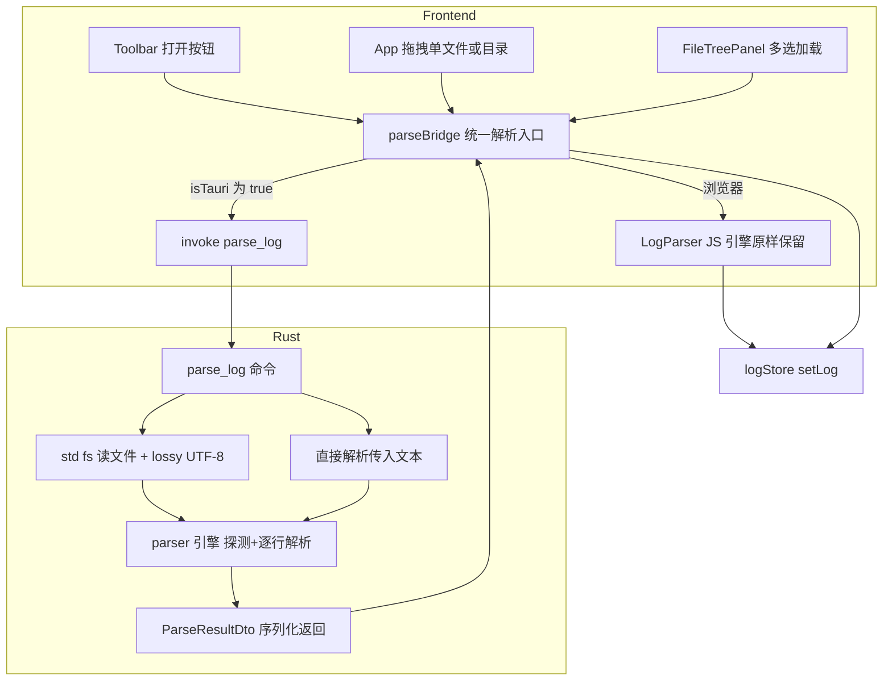

# Rust 原生日志解析引擎 — 双通道架构设计

> 目标：Tauri 桌面端日志解析移入 Rust（原生读文件 + 原生解析），大幅提升大文件加载速度；
> 浏览器（web）端功能与行为**完全不受影响**，继续走现有 JS 引擎。
> 约束：本环境无 Tauri 运行时，只产出设计与代码，由用户在另一环境编译验证。

---

## 1. 背景与动机

现状（Tauri 桌面端加载一个 50MB 日志）：

```
plugin-fs readTextFile（Rust 读文件 → 整个文本序列化过 IPC → JS 字符串）
→ JS 端 String.split + 逐行 RegExp 解析（主线程，卡 UI 数秒）
→ events/rawLines 双份驻留内存
```

问题：
1. **文本过桥两次**（读入 + 解析结果内部传递），IPC 序列化 50MB 字符串开销大；
2. **JS 正则逐行解析**在主线程执行，10 万行级别明显卡顿；
3. Rust 侧（[`lib.rs`](src-tauri/src/lib.rs:1)）只注册了 dialog/fs 插件，**零自定义命令**，没有用到原生计算能力。

## 2. 总体架构 — 双通道



核心原则：
- **单一入口**：前端所有解析调用收敛到 `parseBridge`，内部按 `isTauri()` 分流；
- **语义对齐**：Rust 引擎逐条复刻 JS 行为（时间戳格式、thread/level 提取、行分割、排序稳定性、skipped 统计）；
- **失败回退**：invoke 失败（命令未注册/异常）→ 自动降级回 JS 引擎，功能永不中断；
- **浏览器零改动路径**：`isTauri()` 为 false 时 `parseBridge` 纯粹包装现有 `LogParser`，不加载任何 Tauri 模块（沿用 [`lib/tauri.ts`](src/lib/tauri.ts:1) 的动态 import 模式）。

## 3. Rust 侧设计

### 3.1 模块结构

```
src-tauri/src/
  main.rs            # 不变
  lib.rs             # 注册 parse_log 命令
  parser/
    mod.rs           # DTO 定义 + parse_log 命令 + 组装流程
    timestamp.rs     # 5 种时间戳格式：探测 + 提取（对齐 timestampFormats.ts）
    line.rs          # 行后段解析 thread/level/message（对齐 LogParser.parseRest）
```

### 3.2 命令签名

```rust
/// 统一解析命令：path 与 text 二选一（path 优先），formatId 可选预留。
#[tauri::command]
async fn parse_log(
    path: Option<String>,
    text: Option<String>,
    format_id: Option<String>,
) -> Result<ParseResultDto, String>
```

- 读文件 + 解析放 `tauri::async_runtime::spawn_blocking`，不阻塞 IPC 线程；
- **用 `std::fs` 读文件，不受 plugin-fs scope 限制**（scope 只约束插件命令；本地单机应用无安全顾虑），彻底避免大文本过桥读入；
- 文本来源（`text` 参数）用于兜底与测试场景。

### 3.3 DTO（serde camelCase 对齐 TS 字段）

```rust
#[derive(Serialize)]
#[serde(rename_all = "camelCase")]
struct LogEventDto {
    id: u32,                    // 行号（排序前赋值，同 JS）
    ts: i64,                    // epoch 毫秒
    raw: String,                // 原始整行（不含换行符）
    thread: Option<String>,
    level: Option<String>,
    message: String,
    source_file: Option<String>, // 单文件为 None；多文件合并由前端赋值
}

#[derive(Serialize)]
#[serde(rename_all = "camelCase")]
struct ParseResultDto {
    events: Vec<LogEventDto>,
    raw_lines: Vec<String>,         // 与 JS text.split(/\r?\n/) 逐行对齐（DetailPanel 上下文索引用）
    timestamp_format_id: Option<String>,
    skipped: u32,
    total_lines: u32,
}
```

返回结构 = JS `ParseResult` + `rawLines`，前端零适配成本。

### 3.4 解析流程（对齐 [`LogParser.parse`](src/parser/LogParser.ts:80)）

1. 取文本（path 读文件 or text 参数）：
   - 字节读取 → `String::from_utf8_lossy`（对齐 JS TextDecoder 默认：非法字节替换 U+FFFD，GBK 中文日志不崩溃、行为一致）；
2. 行分割：`split('\n')` + 每段 `strip_suffix('\r')` 一次 —— 等价 JS `/\r?\n/` split（见 §5.1）；
3. 探测格式：取**前 100 个非空行**，对 5 种格式计数，严格大于才更新最优（平局保留数组序在前者）—— 对齐 [`detectTimestampFormat`](src/parser/timestampFormats.ts:124)；
4. 逐行：空行（trim 后空）→ skipped++；按格式提取时间戳失败 → skipped++；成功 → `parse_rest` 提取 thread/level/message，push 事件（id = 行号）；
5. `events.sort_by_key(ts)` —— Rust `sort_by_key` 稳定排序，对齐 JS `Array.sort`（ES2019+ 稳定）；
6. 返回 DTO。

### 3.5 时间戳格式（对齐 [`TIMESTAMP_FORMATS`](src/parser/timestampFormats.ts:30)）

| id | JS 正则 | Rust 实现 | 语义要点 |
|---|---|---|---|
| `iso-local-ms` | `(\d{4})-(\d{2})-(\d{2})[ T](\d{2}):(\d{2}):(\d{2})(?:\.(\d{1,3}))?` | regex crate 同正则 | `Date.UTC` 语义：**越界字段进位**（月 13→次年 1、秒 61→进分），手写 `normalize_parts` + `days_from_civil`（Hinnant 算法，负数用 `div_euclid`） |
| `iso-8601` | `...T...(?:\.(\\d{1,3}))?(Z\|[+-]\\d{2}:?\\d{2})?` | regex crate 同正则 | 偏移 `base - sign*(hh*3600+mm*60)*1000`；`Z`/缺省 = 不修正 |
| `syslog` | `([A-Z][a-z]{2})\s+(\d{1,2})\s+(\d{2}):(\d{2}):(\d{2})` | regex crate 同正则 | 月份表 Jan..Dec；年份取**当前年**（Rust 用 UTC 年，与 JS 本地年在跨年瞬间可能差一年，窗口极小，可接受） |
| `time-only-ms` | `(\d{2}):(\d{2}):(\d{2})(?:\.(\d{1,3}))?` | regex crate 同正则 | 日期部分固定 1970-01-01，即 `days_from_civil(1970,1,1)*86400000 + 时分秒毫秒`（含进位） |
| `epoch` | `(?<!\\d)(\\d{13})(?!\\d)\|(?<!\\d)(\\d{10})(?!\\d)` | **手写扫描**（regex crate 不支持 lookaround） | 见 §3.6 |

毫秒段 `padEnd(3,'0')`：`'1'→100`、`'12'→120`、`'123'→123`。

`Date.UTC` 进位归一化（对齐 JS 越界宽容）：

```rust
// 秒/分/时/日/月逐级进位后走 days_from_civil；正常日志均为合法值，此逻辑仅保证边界行为一致
fn normalize_parts(y: i64, mo: i64, d: i64, h: i64, mi: i64, s: i64, ms: i64) -> i64
```

### 3.6 epoch 格式的无 lookaround 实现

JS 语义：`(?<!\d)\d{13}(?!\d) | (?<!\d)\d{10}(?!\d)`，`.match()` 取最左匹配，同一起始位置 13 位分支优先。

等价手写算法：
1. 从左到右扫描行，切出所有**极大数字段**（前后均非数字）；
2. 遇到第一个长度为 **13 或 10** 的极大段即命中（一个段长度只能是二者之一，天然满足"同位置 13 优先"）；
3. 长度 13 → 直接为 ts；长度 10 → ×1000；
4. `is_match`（探测计数用）= 存在这样的段。

> 注意不是"先扫全部 13 位再扫 10 位"——那会与 JS 最左优先语义不一致。

### 3.7 行后段解析（对齐 [`parseRest`](src/parser/LogParser.ts:42)）

```
rest（时间戳后剩余）→ js_trim
1. thread: ^\[([^\]]+)\]\s*    → 命中则剥除后再 js_trim
2. level 裸写: ^([A-Z]+)\s+ 且属于 LEVELS（大小写敏感，词后必须有空格）
3. 否则 level 括号: (?:\[|\()([A-Za-z]+)(?:\]|\))\s*   【无锚点，取最左匹配】
   且 LEVELS.contains(upper(捕获))，level = upper(捕获)
```

- `js_trim` = Rust `str::trim` + 额外剥离 U+FEFF（JS trim 集合含 BOM，Rust `char::is_whitespace` 不含）；
- LEVELS 集合（20 项）原样照搬，含单字母 `I D W E F`；
- regex crate 采用 leftmost-first 语义（与回溯引擎一致），捕获组结果一致。

### 3.8 依赖变更

```toml
# Cargo.toml [dependencies] 新增：
regex = "1"
```

不引入 chrono（时间算法手写，约 30 行）、不引入 rayon（V1 顺序解析）。

### 3.9 Rust 单元测试（`cargo test`）

`parser/` 模块内 `#[cfg(test)]`：
- 5 种格式各若干正/反例（含毫秒 padEnd、时区偏移、越界进位、epoch 10/13 位与"先左后型"语义）；
- `parse_rest`：thread 剥离、裸 level、括号 level、小写 `[info]` → INFO、行尾裸词（无尾随空格）不识别为 level；
- 行分割：`\r\n` / `\n` / 混合 / 空文本（`[""]`）/ 尾部换行（末尾多一空行）；
- 稳定排序：相同 ts 保持原行序；
- skipped 统计：空行 + 无法提取时间戳的行。

## 4. 前端桥接设计

### 4.1 新增 [`src/parser/parseBridge.ts`](src/parser/parseBridge.ts:1)

```ts
import { LogParser, type ParseResult } from './LogParser';
import { isTauri } from '../lib/tauri';

export interface FullParseResult extends ParseResult {
  rawLines: string[];           // JS 路径 = text.split(/\r?\n/)
}

/** 解析一段文本：Tauri → Rust；浏览器 → JS（永不加载 Tauri 模块） */
export async function parseLogText(text: string): Promise<FullParseResult>

/** Tauri 专用：按绝对路径解析（核心红利：文本不过 IPC 桥） */
export async function parseLogPath(path: string): Promise<FullParseResult | null>

/** 统一入口：LoadedFile 可能带 path（Tauri）或只有 text（浏览器） */
export async function parseLoadedFile(loaded: { name: string; text: string; path?: string }): Promise<FullParseResult | null>
```

内部：
- `isTauri()` → 动态 `import('@tauri-apps/api/core')` → `invoke('parse_log', { path?, text?, formatId? })`；
- invoke 异常 → `console.warn` + **回退 JS 引擎**（返回 null 由调用方 fallback，或直接内部 fallback，见 4.2）；
- 校验返回形状（events 数组）不合法同样回退。

### 4.2 [`LoadedFile`](src/io/fileLoader.ts:14) 扩展

```ts
export interface LoadedFile {
  name: string;
  size: number;
  text: string;
  path?: string;   // Tauri 下存在：不再 readTextFile，只 stat 取 size
}
```

- [`openLogFileDialog`](src/io/fileLoader.ts:67)：Tauri 分支**删除 `readTextFile`**，仅 `stat` 取 size，返回 `{ name, size, text: '', path }`；
- [`loadTauriPaths`](src/io/fileLoader.ts:99)：同上。

> 回退保障：若 Rust 命令不可用而 text 为空 → parseBridge 再用 plugin-fs 按路径读一次文本走 JS（保证降级路径功能完整）。

### 4.3 三个调用点改造

| 调用点 | 现状 | 改造后 |
|---|---|---|
| [`Toolbar.handleLoaded`](src/components/Toolbar.tsx:43) | `parser.parse(loaded.text)` + `text.split` | `parseLoadedFile(loaded)` → `setLog(r.events, r.rawLines, {...})` |
| [`App.handleLoaded`](src/App.tsx:137) | 同上 | 同上 |
| [`dirLoader.mergeParsed`](src/io/dirLoader.ts:253) | 接收 `{name,text}[]` 内部 parse | 拆为 `mergeParsedInputs({name, parse: FullParseResult}[])`；浏览器路径先逐文件 JS parse（含 rawLines），Tauri 路径在 [`loadMultiple`](src/io/dirLoader.ts:297) 循环里逐文件 `parseLogPath`，**onProgress 进度回调语义不变** |

多文件合并规则不变：全局 id 重编号、sourceFile 标记、全局按 ts 排序、rawLines 拼接。

### 4.4 浏览器路径回归保证

- `parseLogText` 非 Tauri 分支 = 原 `new LogParser().parse(text)` + `text.split(/\r?\n/)`，逐字符等价；
- 所有 Tauri 分支都在 `isTauri()` 守卫内，动态 import 不触发（纯浏览器 `npm run dev` 不加载任何 `@tauri-apps/*` 代码）；
- `dirLoader` 浏览器分支（FSA / webkitGetAsEntry）代码不动，仅把"parse+split"换成 parseBridge 的浏览器实现。

## 5. 关键语义对齐清单（实现验收标准）

### 5.1 行分割

| 输入 | JS `split(/\r?\n/)` | Rust 实现 |
|---|---|---|
| `"a\r\nb"` | `["a","b"]` | split('\n') + strip 一个 '\r' ✓ |
| `"a\rb"` | `["a\rb"]`（单独 \r 不切） | split('\n') 不切 ✓ |
| `"a\r\r\nb"` | `["a\r","b"]` | "a\r\r" strip 一个 → "a\r" ✓ |
| `""` | `[""]` | `[""]` ✓ |
| `"a\n"` | `["a",""]` | ✓ |

### 5.2 已知可接受差异（文档化）

1. **syslog 年份**：JS 取本地时区当前年，Rust 取 UTC 当前年 —— 仅跨年瞬间（本地与 UTC 年份不同的几小时）可能不同；
2. **rest 切分定位**：JS 用 `raw.indexOf(matchStr)`（matchStr 更早重复出现时取错位置的历史怪癖），Rust 用真实匹配区间 —— 仅在"时间戳子串在行内更早位置重复出现"的构造性输入下不同，实际等价更正确；
3. **`\s`/trim 的 U+FEFF**：Rust 侧已用 `js_trim` 补齐 trim 差异；正则 `\s` 中 U+FEFF 的差异仅出现在 BOM 出现在行中部的场景，概率趋近于零。

### 5.3 一致性自检工具（可选，dev only）

开发模式下加 URL 参数 `?dualengine=1`：`parseLoadedFile` 同时跑 JS 与 Rust 两引擎，deep-compare `events/ts/thread/level/message/rawLines/skipped/totalLines`，差异输出 console。用户在验证环境可用 [`sample/sample.log`](sample/sample.log:1) 与 [`sample/sample_large.log`](sample/sample_large.log:1) 自检。

## 6. 性能预期

| 环节 | 现状（JS） | Rust 后 |
|---|---|---|
| 文件读取 | readTextFile 整文本过 IPC | std::fs 进程内读取（零过桥） |
| 行分割 + 正则逐行 | JS 主线程（卡 UI） | Rust 线程池（spawn_blocking，UI 不卡） |
| 结果传输 | — | events+rawLines JSON 一次过桥（serde_json 高速序列化） |

50MB / 10 万行量级：JS 端秒级卡顿 → 预期亚秒级完成；后续若需再提速，可走 bincode + ArrayBuffer 传输（见 §8）。

## 7. 验证清单（用户在 Tauri 环境执行）

1. `cd src-tauri && cargo test` —— Rust 单测全绿；
2. `npm run tauri:dev`：
   - [ ] Toolbar「打开日志」选单文件 → 事件数/skipped/格式 id 与浏览器版一致；
   - [ ] 拖拽单文件入窗口 → 同上；
   - [ ] 拖拽目录 → 文件数、合并结果、sourceFile 正确；
   - [ ] FileTreePanel 多选加载 + 进度回调正常；
   - [ ] `?dualengine=1` 双引擎 diff 无差异（sample.log / sample_large.log）；
   - [ ] 故意改错命令名模拟 invoke 失败 → 自动回退 JS，功能不中断；
   - [ ] 窗口拖拽高亮等既有交互不回归；
3. 浏览器回归：`npm run dev` → 打开/拖拽/目录加载全流程原样可用（不加载任何 Tauri 模块，Network 面板无 @tauri-apps chunk 请求）。

## 8. 后续优化路径（本期不做）

- 多文件并行解析（rayon），完成后按序合并；
- bincode + ArrayBuffer 二进制传输替代 JSON，降低 IPC 体积；
- 解析进度事件（`emit` 分批推送）支持流式 UI；
- 过滤匹配（FilterEngine）与序列匹配（SequenceMatcher）逐步 Rust 化。

## 9. 实施步骤

见任务清单（todo）。产出物：
- Rust：`src-tauri/src/parser/{mod.rs, timestamp.rs, line.rs}` + `lib.rs` 注册 + `Cargo.toml` 依赖 + 单测；
- 前端：`src/parser/parseBridge.ts`（新增）、`src/io/fileLoader.ts`、`src/io/dirLoader.ts`、`src/components/Toolbar.tsx`、`src/App.tsx`（改造）；
- 文档：README Tauri 章节补一行说明。
