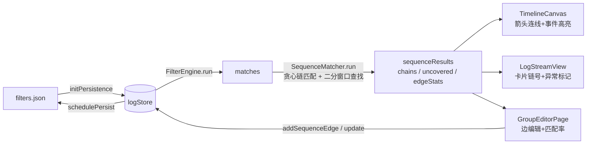

# Group 图关联（串行序列匹配）设计

## 目标
在 group 内声明 filter 之间的**串行时序关系**（日志A → 日志B → 日志C），
匹配引擎在事件流上找出完整链，三个视图以**高亮 + 小箭头连线**呈现；
支持**异常开关**：开启后把不符合模式的（未被链覆盖的）事件标为异常。

## 已确认决策
1. **第一阶段范围**：串行序列 + 每边时间窗约束（链匹配 + 断裂异常检测）。
   后续可扩展：fork-join 汇聚/分支、NOT 禁止边、周期心跳。
2. **时间窗**：每条边独立 `maxGapMs`（默认 1000ms），编辑入口在节点画布的连线上（点击边弹编辑框）。
3. **呈现**：三个视图全做——TimelineCanvas 连线高亮、LogStreamView 卡片标记链号、GroupEditorPage 边匹配率统计。

## 数据模型

### `src/types.ts`

```ts
/** 序列边：group 内 filter 间的串行时序约束 */
export interface SequenceEdge {
  id: string;
  fromFilterId: string;
  toFilterId: string;
  /** 相邻两事件最大间隔毫秒：tsB - tsA ∈ (0, maxGapMs] 才算边成立 */
  maxGapMs: number;
}

/** group 的序列匹配配置（挂在 FilterGroup 上） */
export interface SequenceConfig {
  edges: SequenceEdge[];
  /** 异常开关：开启后未覆盖事件标红 */
  anomalyEnabled: boolean;
}

// FilterGroup 追加：
export interface FilterGroup {
  // ...原有字段
  /** 串行序列关系配置；undefined=未配置（不参与匹配） */
  sequence?: SequenceConfig;
}

/** 一条完整匹配链 */
export interface MatchedChain {
  groupId: string;
  /** 链上各步事件（按时间序，与边一一对应） */
  steps: { edgeId: string; filterId: string; event: LogEvent }[];
  startTs: number;
  endTs: number;
}

/** group 的序列匹配结果 */
export interface SequenceMatchResult {
  groupId: string;
  chains: MatchedChain[];
  /** 未被任何链覆盖的组内事件（异常候选） */
  uncoveredEvents: LogEvent[];
  /** 每条边命中统计：matchedCount=成功推进次数；missCount=从源事件出发找不到窗口内目标事件的次数 */
  edgeStats: { edgeId: string; matchedCount: number; missCount: number }[];
}
```

## 匹配算法（`src/sequence/SequenceMatcher.ts` 新文件）

**链解析**：`edges` 中入度为 0 的 filter 为链起点，DFS 沿边延伸得到有序链（如 A→B→C）。
孤立边自成一条链。

**贪心链匹配**（每事件至多属于一条链，防复用）：
```
for 每条链 [F0 → F1 → … → Fn]:
  for F0 的每个事件 e0（ts 升序，未被消耗）:
    cur = e0; chain = [e0]
    for 每条边 (Fi → Fi+1, maxGapMs):
      归并扫描 (cur.ts, cur.ts + maxGapMs] 窗口内 Fi ∪ Fi+1 的事件（跳过已消耗）：
        先遇到 Fi+1 的事件 → 推进（chain.push，cur = 该事件）
        先遇到另一个 Fi 实例（严格晚于 cur.ts）→ 断裂：B 缺失，记 missCount++，本链废弃
        窗口耗尽未遇到 Fi+1 → 断裂（超时）
    全部推进成功 → 产出 MatchedChain，标记各步事件已消耗
```
**插队语义**：A→B 之间允许夹杂任何其他类型日志（不在扫描视野内，天然不阻断）；
但窗口内若先出现**另一个 A 实例**，说明这个 A 的 B 已缺失（如 `A → A → B` 中第一个 A 异常）。
复杂度 O(N log M)（双指针二分起点 + 事件升序数组），复用 [`bisectLeft`](src/timeline/correlation.ts:13)。

**未覆盖事件**：group 内所有 filter 的匹配事件 − 被消耗事件 = `uncoveredEvents`。

**入口**：`logStore.recomputeMatches()` 末尾联动 `recomputeSequences()`
（输入 matches + groups，输出 `sequenceResults: Record<groupId, SequenceMatchResult>`）。

## Store 变更（`src/store/logStore.ts`）

```
sequenceResults: Record<string, SequenceMatchResult>;
recomputeSequences: () => void;
// 边 CRUD（均更新 group.sequence 后 recomputeSequences + schedulePersist）
addSequenceEdge: (groupId, fromFilterId, toFilterId, maxGapMs?) => string;
updateSequenceEdge: (groupId, edgeId, patch: Partial<SequenceEdge>) => void;
removeSequenceEdge: (groupId, edgeId) => void;
toggleSequenceAnomaly: (groupId) => void;
```

## 视图呈现

### 1. GroupEditorPage（`src/components/NodeCanvasView.tsx`）— 编辑入口
- **边绘制**：SVG overlay 层（画布坐标换算同现有 toScreen），组内 filter 节点间画带箭头曲线，边色 = 源 filter 色；命中率高→实线，低→虚线；边中点标注 `maxGapMs` 与匹配率（如 `1s · 85%`）。
- **连线交互**：工具栏新增 `🔗 连线` 模式开关；模式下从节点右缘拖出橡皮筋线到目标节点松开 → `addSequenceEdge`；点击边 → 编辑弹窗（maxGapMs 数字输入、删除按钮）。
- **异常开关**：工具栏 `⚠ 异常` toggle → `toggleSequenceAnomaly`。
- **节点卡片**：追加链参与数角标（该 filter 被链消耗的事件数）。

### 2. TimelineCanvas（`src/timeline/renderers.ts` + `TimelineCanvas.tsx`）— 箭头连线
- 新增 `drawSequenceLinks(rc, rows, sequenceResults)`：链上相邻步事件间画**跨 lane 箭头连线**（从上行事件 x/y 到下行事件，二次贝塞尔 + 箭头头部，线色 = group.color，透明度区分多链）。
- `drawLaneEventsAt` 增强：新增 `chainEventIds: Set<number>` 参数——链上事件用 group 色描边加粗；异常开启时 `uncoveredEvents` 用警示红。
- `drawGroupHeader` 增强：追加链统计文案（`⛓ 12 链 · 3 异常`）。

### 3. LogStreamView（`src/components/LogStreamView.tsx`）— 卡片链号
- 卡片左上角**链号角标**（同链同号同 group 色，如 `#3`）；异常开启时未覆盖卡片红色警示边。
- group 标题列追加统计（链数 / 异常数）。

## 持久化
`FilterGroup.sequence` 随 groups 整体存入 filters.json（[`filterPersist.ts`](src/io/filterPersist.ts:24) 为整存整取，新字段天然向后兼容：旧文件无 `sequence` = 未配置）。

## 架构流程



## 影响范围
| 文件 | 改动 |
|------|------|
| src/types.ts | +SequenceEdge / SequenceConfig / MatchedChain / SequenceMatchResult；FilterGroup.sequence |
| src/sequence/SequenceMatcher.ts（新） | 链解析 + 贪心匹配 + 未覆盖计算 |
| src/store/logStore.ts | +sequenceResults / recomputeSequences / 边 CRUD / anomaly toggle |
| src/components/NodeCanvasView.tsx | SVG 边层 + 连线交互 + 边编辑弹窗 + 异常开关 + 统计 |
| src/components/NodeCanvasView.module.css | 边 / 弹窗 / 角标样式 |
| src/timeline/renderers.ts | +drawSequenceLinks；drawLaneEventsAt / drawGroupHeader 增强 |
| src/timeline/TimelineCanvas.tsx | 渲染循环接入链连线 / 高亮 / 统计 |
| src/components/LogStreamView.tsx | 卡片链号 + 异常标记 + 组统计 |
| src/components/LogStreamView.module.css | 角标 / 异常样式 |
