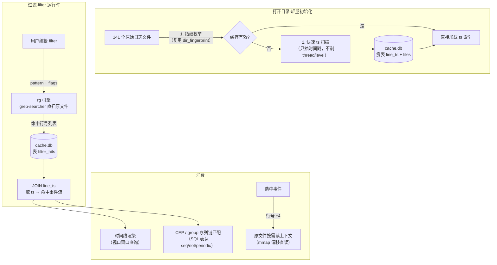

# v2 架构设计：rg 直扫 + SQL 只存 filter 结果

> 状态：**已实施**（PR-1/PR-2/PR-3 已完成；PR-4 大数据加速路径已实现并接入 dbMode）
> 日期：2026-09-30（设计稿）；2026-10-01（实施核对）
>
> ## 实施状态核对（2026-10-01）
> - **PR-1 瘦表改造**：✅ 完成。`db.rs` 已是 `meta/files/line_ts/filter_hits` 瘦表，
>   `SCHEMA_VERSION="2"`，指纹+schemaVersion 双校验；v1 大表（lines/events/FTS5）全代码库无引用。
> - **PR-2 rg 引擎**：✅ 完成。`raw_search.rs`（grep-searcher 直扫 + CRLF 配对 + 4 单元测）；
>   `db_filter` 写 `filter_hits` 后 `JOIN line_ts` 返回 `(line,ts)[]`；前端 `runDbFilter` 接入。
> - **PR-3 按需取数**：✅ 完成。`db_context_lines / db_line / db_events_in_window / db_event_index_chunk`
>   全部按行号直读原文件或查 `line_ts`，不存文本；`DetailPanel` 走 `db_context_lines`。
> - **PR-4 CEP SQL 下推（可选）**：✅ 已完成加速路径。`src-tauri/src/sequence.rs` 新增
>   `db_run_sequences` 命令：从 `filter_hits JOIN line_ts` 取事件流，在 Rust 侧跑贪心链匹配。
>   覆盖范围 = **global 作用域 + seq/and/or/not 边**（与前端 `SequenceMatcher` 核心语义一致）。
>   **超出范围的特性（thread 分桶 / nodeConditions / nodeCounts / opt / periodic）整体回退前端
>   TS 引擎**（`recomputeSequences` 的 dbMode 分支：Rust 返回 `fallback=true` 即调用
>   `runSequenceMatching`）。另外 dbMode 下命中事件无 thread/message，thread 分桶本就无意义。
> - 附带修复（同轮）：`App.tsx`/`LogStreamView.tsx` 在 dbMode 下已支持「表格流/时间线」切换
>   （LogStreamView 惰性 `fetchContextLines` 取行文本），不再强制时间线。
> - 一处说明：`db_open` 重建分支 `for suffix in ["","-wal","-shm"]` 中的空串项已删除主
>   `cache.db` 文件，v1 遗留库会被物理清掉后重建，符合「schema 不符自动删库重建」。
> 背景：v1（SQL 存全量文本）实测失败——720MB 原始日志建库膨胀到 3GB+、建库数分钟、
> 扫描路径远慢于 rg（1 秒）。用户裁决：**SQL 存全量是本末倒置**。
> rg 实测基准：`rg -o "pengtest frame|pengtest vk" <目录>` 720MB 约 1 秒。
> ## v3 性能改造（2026-10-08，本轮）
> 前端三份 JS 物化（500 万骨架 LogEvent + dbLineIndex Map + 视口行文本整区间）与
> 同步命令阻塞 UI 是 dbMode 剩余瓶颈，本轮五项修复（详见 §7）：
> 1. 索引改二进制 SoA IPC（`db_event_index_chunk` 返回 `ipc::Response`，前端 typed array 直读），
>    事件不再物化成对象（`events: []`），行号 → ts 走 `posByLine` O(1) 直查；
> 2. message scope 二次校验改按文件单趟（O(总字节)，替代 O(hits×文件大小) 的逐行整文件重读）；
> 3. files 表新增 `line_offsets` BLOB，`db_line/db_context_lines/视口行文本` 全部 seek 直读片段；
>    视口契约从 min/max 行号区间改为 **id 集合分批**（`db_lines_by_ids`，500/批 + 20k LRU）；
> 4. 同步命令全部 `spawn_blocking` + **连接并发化**（全局单连接 Mutex 改为存路径、
>    每命令独立开连接：WAL 并发读，慢查询不再持锁阻塞行文本/详情命令——实测回归修复）；
> 5. 关联窗口下推 SQL（`db_corr_ids`：line_ts 覆盖索引范围扫 + filter_hits 主键 EXISTS 点查，
>    替代 JS 每次视图变化 O(总命中数) 扫 matches）。
> schemaVersion → **3**（旧库自动重建）；`tsconfig` lib 升 ES2024（Promise.withResolvers）。

## 1. 核心思想

**原始文件就是数据库**（rg 直扫，零预处理零冗余）；**SQL 只存衍生数据**（filter 命中结果，
供 CEP/序列匹配/渲染查询）。回到用户最初的设想：SQL 是为 CEP 服务的查询层，不是文本仓库。



## 2. 数据流与存储

### 2.1 原始文件（唯一真源）
- 不做任何全量转换。文件枚举 + 指纹（rel+size+mtime FNV）沿用 [db.rs](../src-tauri/src/db.rs) 现有实现
- 搜索 = `grep-searcher` crate（rg 内核：mmap + SIMD + memchr），多文件可并行
- 上下文 = 按行号直接 mmap 读原文件片段

### 2.2 ts 索引（瘦表，方案 A）
打开目录时一次性扫描（**只提取时间戳，不剥 thread/level/message**）：

```sql
CREATE TABLE files (
  fid       INTEGER PRIMARY KEY,
  name      TEXT NOT NULL UNIQUE,   -- 相对路径
  first_line INTEGER NOT NULL       -- 该文件首行的全局行号
);
CREATE TABLE line_ts (              -- 瘦表：~16B/事件行
  line INTEGER PRIMARY KEY,         -- 全局行号
  ts   INTEGER NOT NULL             -- epoch ms（无时间戳的行不入表）
);
CREATE INDEX idx_line_ts_ts ON line_ts(ts, line);
```

- 720MB ≈ 500 万事件行 → **~80MB 表**（vs v1 的 3GB，缩小 37 倍）
- 扫描成本：时间戳正则 + int 解析 ≈ rg 级速度，预计 **2~5 秒一次性**
- 进度事件：`ts_scan_progress`（逐文件）
- 缓存：指纹不变直接复用；注意 ts 扫描依赖与 v1 相同的行切分语义（`split('\n')` 剥 `\r`）

### 2.3 filter 命中结果（核心新表）
每次 filter 运行（新增/编辑/启用）后写入：

```sql
CREATE TABLE filter_hits (
  filter_id TEXT NOT NULL,          -- 前端 filter id（f{ts}_{seq}）
  line      INTEGER NOT NULL,       -- 全局行号
  PRIMARY KEY (filter_id, line)
) WITHOUT ROWID;
CREATE INDEX idx_hits_line ON filter_hits(line);
```

- 大小：一条命中 ≈ 20B。1 万命中 = 200KB；**命中百万级也才 20MB**
- filter 编辑 = `DELETE FROM filter_hits WHERE filter_id=?` + 重扫重插（事务）
- **绝不存文本**——文本永远从原文件按需读

### 2.4 CEP / 序列匹配（SQL 本位，用户初始动机）
group 序列链（现有 [SequenceMatcher.ts](../src/sequence/SequenceMatcher.ts) 的图语义）下推 SQL：

```sql
-- 例：seq 边 A→B（窗口 maxGapMs）的链推进
WITH a AS (SELECT line, ts FROM filter_hits h JOIN line_ts t USING(line)
           WHERE h.filter_id = :filterA),
     b AS (SELECT line, ts FROM filter_hits h JOIN line_ts t USING(line)
           WHERE h.filter_id = :filterB)
SELECT a.line, b.line, b.ts - a.ts AS gap
FROM a JOIN b ON b.ts > a.ts AND b.ts <= a.ts + :maxGap
ORDER BY a.ts, b.ts;
```

- seq/not/and/or/periodic 全部可用 SQL 表达（窗口 join + NOT EXISTS + 分组断言）
- v1 迁移期：前端 SequenceMatcher 保留（小数据/浏览器模式），SQL 版做大数据加速路径

## 3. 运行时行为

| 操作 | v2 路径 | 预期耗时（720MB） |
|------|---------|------------------|
| 打开目录（首次） | 指纹 + ts 扫描建瘦表 | 2~5 秒（带进度） |
| 打开目录（二次） | 指纹命中，挂库 + 读 files/line_ts 计数 | **<0.5 秒** |
| 新建/编辑 filter | rg 直扫（敏感/不敏感/regex 同速）+ 写 filter_hits | **~1 秒**（= rg 基准） |
| 时间线渲染 | filter_hits JOIN line_ts，视口 ts 窗口查询 | 毫秒级 |
| 选中事件详情 | 原文件 mmap 按行号读 ±4 行 | 毫秒级 |
| 序列链匹配 | SQL（上表） | 亚秒级 |

## 4. 代码迁移计划

### 4.1 Rust 侧
| 现有资产 | 处置 |
|---------|------|
| [db.rs](../src-tauri/src/db.rs) 文件枚举/指纹/walk_log_files | **保留复用** |
| db.rs SCHEMA（lines/events/FTS5 大表） | **删除**（替换为瘦表 schema） |
| db.rs db_open 重建流程 | **改造**：ts 扫描代替全量建库（复用 `extract_timestamp`，跳过 parse_rest_offsets） |
| db.rs db_filter | **重写**：调 raw_search（grep crate）→ 写 filter_hits → 返回 (line, ts)[] |
| db.rs db_context_lines / db_events_in_window | **重写**：数据源改原文件 mmap + line_ts JOIN |
| db.rs parse_rest_offsets / contains_ci / 正则缓存 | parse_rest_offsets **保留**（详情行懒解析 thread/level 用）；contains_ci **废弃**（grep 引擎接管） |
| 新增 raw_search.rs | grep-searcher 封装：`search_dir(pattern, flags) → Vec<(fid, local_line)>`，行号映射经 files.first_line |
| Cargo.toml | + grep-searcher / grep-regex；rusqlite 保留 |

### 4.2 前端
| 现有资产 | 处置 |
|---------|------|
| [dbStore.ts](../src/io/dbStore.ts) | 改造：db_open 参数不变；fetchEventIndex → 读 line_ts；runDbFilter → 新 db_filter（返回 (line,ts)[]） |
| logStore dbMode/setLogDb | **简化**：events 骨架改为「打开时只装 files 元数据」，filter 命中后按需组装；或保留现状（骨架 12B/行，500 万=60MB，可接受） |
| DetailPanel 异步上下文 | **保留**（数据源换 mmap 读） |
| FilterEngine TS 版 | **保留**（浏览器/普通模式主路径；dbMode 才下推） |
| SequenceMatcher TS 版 | **保留**（v1 兼容）；SQL 版列为后续迭代 |

### 4.3 实施顺序（3 个 PR）
1. **PR-1 瘦表改造**：新 schema + ts 扫描 + db_open 改造（删除大表逻辑）+ 保留指纹缓存
2. **PR-2 rg 引擎**：raw_search.rs + db_filter 重写（filter_hits 写入）+ 前端 dbStore 适配
3. **PR-3 按需取数**：db_context_lines/db_events_in_window 重写（mmap 源）+ 渲染层视口查询验证
   （可选 PR-4：CEP SQL 下推）

### 4.4 兼容与回退
- 浏览器模式（无 Tauri）：完全不受影响（JS 路径）
- Tauri 普通单文件加载：走 parse_log 原路径
- dbMode 仅在「目录全选加载」时启用（现有触发条件不变）
- **旧 cache.db 处置**：schema 版本号（meta.schemaVersion=2）不符 → 自动删库重建（用户无感）
- 失败回退：rg 扫描/db 操作任一失败 → 回退 v1 逐文件路径（现有降级链保留）

## 5. 风险与开放问题

| 风险 | 对策 |
|------|------|
| ts 扫描 2~5 秒仍嫌慢 | 首次进度条 + 二次免扫；后续可并行化（按文件分线程） |
| rg 对 CRLF/编码的处理与 JS split 语义差异 | grep-searcher 行号 = `\n` 计数，与 `split('\n')` 天然一致；`\r` 剥离在 ts 扫描与上下文读取时各自处理 |
| filter_hits 与原文件漂移（文件被外部修改） | 指纹在每次打开校验；运行期修改未覆盖（v1 同样限制，暂接受） |
| message scope 过滤（时间戳后正文） | rg 直扫整行（raw scope）；message scope 需行内偏移——首版用「命中后二次校验偏移区间」，或降级 SQLite 扫描（保留现路径） |
| LogStreamView（文本流视图） | dbMode 下仍强制时间线视图（v1 现状）；后续可按需流式读原文件支持 |

## 6. 与 v1 的量级对比

| 指标 | v1（SQL 存一切） | v2（rg + 瘦 SQL） |
|------|----------------|-------------------|
| 磁盘占用 | 3GB+3GB wal | ~80MB（line_ts）+ KB 级（filter_hits） |
| 首次打开 | 数分钟建库 | 2~5 秒 ts 扫描 |
| 二次打开 | 秒级 | <0.5 秒 |
| filter（不敏感子串） | 数秒~数十秒（慢路径） | **~1 秒（rg 同速）** |
| filter（敏感 ≥3 字符） | FTS 毫秒级 | ~1 秒（rg；如需毫秒可保留 FTS 作为可选加速层） |
| 内存驻留 | 前端 60MB 骨架 + Rust 3GB | 前端 60MB 骨架 + Rust ~100MB |

## 7. v3 性能改造（2026-10-08）

v2 落地后 dbMode 的剩余瓶颈（性能分析核实）：索引搬运/物化/逐行回读，而非扫描本身。

### 7.1 索引 SoA + 二进制 IPC
- `db_event_index_chunk` 返回 `tauri::ipc::Response`（原始字节），布局
  `[count u32][pad u32][ts × f64 LE][line × u32 LE]`——ts 落 offset 8（Float64Array 对齐），
  epoch ms < 2^53 用 f64 无损编码；前端 `fetchEventIndex` typed array 直读，零对象解析
- 前端不再物化 500 万骨架 `LogEvent`（旧版 `events.map(...)` + `dbLineIndex` Map + 视口行文本
  三份拷贝）：`dbMode` 下 `events: []`，`dbIndex = { count, lines, ts, posByLine }`
  （`posByLine[line]` = 事件下标，0xFFFFFFFF = 无事件行），`dbTsByLine` O(1) 查 ts
  （替代 `events.find` O(N)，用于 selectEvent/focusEvent/recomputeCorrelations/TimelineCanvas）
- 事件总数显示统一走 `selectEventCount` selector（dbMode = `dbIndex.count`）

### 7.2 message scope 单趟校验
旧版对每个候选命中行 `read_file_lossy` 整文件重读 + 每 hit 编译一次正则
（O(hits × 文件大小)）。新版 `message_scope_filter`：候选行号排序去重后按文件分组
（files 与候选均按 first_line 升序 → 双指针），每文件单趟行游标单调推进，
正则只编译一次（编译失败 = Never，保持旧语义）。总代价 O(总字节)。

### 7.3 行偏移 BLOB + seek 读取
- `files` 表新增 `line_offsets BLOB`（每行起始字节偏移 u64 LE 数组，行 i 区间 =
  `[off[i], off[i+1] 或文件尾)`），建库扫描单趟顺带记录（与 `split('\n')` 分段语义一致，
  含尾部空行段）
- `db_line` / `db_context_lines` 改 `read_line_range` seek 只读目标片段（不再整文件读）；
  `db_context_lines` 的文件行上界改 `files.get(idx+1)`（修掉循环内嵌套 filter 的 O(files²)）
- **视口行文本契约变更**：旧版「视口 min/max 行号区间」（多文件时间交叠时区间横跨数百万行）
  改为 **id 集合分批**——新命令 `db_lines_by_ids(ids)`：排序去重 + 同文件 gap≤64 合并段
  seek 读取，返回 `[count][pad] + 每行 [line][len][utf-8]`；前端 500/批拉取 +
  20,000 行 LRU（Map 插入序驱逐）。DetailPanel 的 ±ctxSpan 小区间仍走 `db_context_lines`

### 7.4 同步命令 spawn_blocking
Tauri 同步 command（`pub fn`）在主线程执行。`db_filter_drop`（百万行 DELETE）、
`db_context_lines`、`db_line`、`db_events_in_window`、`db_event_index_chunk`、
`db_run_sequences` 全部改 `pub async fn` + `spawn_blocking`。

### 7.5 连接并发化（实测回归修复）
spawn_blocking 只解决了主线程卡顿，第一版仍保留**全局单连接 `Mutex<Connection>`**——
所有命令在锁上串行。实测（百万级命中）：`db_corr_ids` 窗口查询持锁期间，
`db_lines_by_ids`/`db_context_lines`/`db_line` 全部排队，表现为点击事件后
详情/原始行长时间无响应（滚动靠已缓存行文本仍可翻）。
修复：全局只存 **cache.db 路径**，每个命令 `Connection::open` 独立连接
（`open_cache()`，cache_size 64MB + busy_timeout 5s）。WAL 是库级持久属性，
新连接自动继承 → **读命令完全并发**；写命令（filter_hits 事务/DELETE）之间靠
busy_timeout 串行等待，读写互不阻塞（WAL snapshot 隔离）。

### 7.6 关联窗口下推 SQL
`recomputeCorrelations` 旧版每次视图变化 JS 全量扫 `matches`（O(总命中数)）。
新命令 `db_corr_ids(filterIds, start, end)`：
```sql
SELECT t.line FROM line_ts t
WHERE t.ts BETWEEN ?1 AND ?2
  AND EXISTS (SELECT 1 FROM filter_hits h
              WHERE h.filter_id IN (...) AND h.line = t.line)
```
line_ts (ts,line) 覆盖索引范围扫（窗口行）驱动，每行对 filter_hits 主键做 EXISTS
点查（命中即短路，免 CROSS JOIN + DISTINCT 的去重开销；EXPLAIN 断言 SEARCH +
idx_line_ts_ts）；前端模块级 `corrSeq` 序号丢弃过期响应。

### 7.7 详情无限上下文流（v3.1）
旧版详情 = 选中行 ±ctxSpan 固定区间（`db_context_lines`，已删）。改为
`ContextStream` 组件：**全局行号连续空间的无限虚拟滚动**，滚出文件边界继续显示
相邻文件内容。
- **滚动模型**：百万行 × 22px 总高远超浏览器 scrollTop 上限（Chrome ~33.5M px），
  原生滚动不可用 → wheel 驱动自管 offset + 自绘滚动条 + 键盘（↑↓/PgUp/PgDn），
  行号空间任意大精确；
- **item 空间**：行与文件分隔条统一 22px 高；`files[i]` 分隔条 item = firstLine_i + i，
  行 L（文件 i）item = L + i + 1（bisect O(log files) 互逆，smoke 验证）；
- **懒加载**：视口 ±120 行 → 缺失行号 `db_lines_by_ids` 批 500 拉取（复用合段 seek），
  行文本 Map LRU 上限 4000（约 800KB，超限驱逐最旧、保留本批）；
- **文件名**：文件边界分隔条（名称 + 起始行号，title 绝对路径）+ 头部来源 tag（tooltip
  绝对路径）。新增 `db_files` 命令（firstLine/name/绝对路径，firstLine 升序）；
- **右键**（行与分隔条）：在文件管理器中定位（Win `explorer /select,`）、外部应用打开
  （Win `cmd /C start`；mac `open [-R]`；Linux `xdg-open`）——`std::process::Command`
  零新依赖（未引入 tauri-plugin-opener，避免该环境拉取新 crate），参数传递无 shell 注入面；
  失败走 toast。
- 非 dbMode 保持 ±ctxSpan 固定窗口（数据全在内存）；`db_context_lines`/`DbContextRow`
  及前端 `fetchContextLines` 已删（无消费者）。

### 7.8 schema 与兼容
- `SCHEMA_VERSION = "3"`：v2 库打开时自动删库重建（files 表结构变了）
- meta 新增 `totalEvents`（cache-hit 免 COUNT 全索引扫描）
- `tsconfig.json` lib ES2020 → ES2024（`Promise.withResolvers`；target 仍 ES2020，产物不变）
- Rust 单测（db.rs 尾）：偏移语义（split('\n') 对齐含 CRLF/多字节）、`read_line_range`
  边界、`merge_line_segments` gap 边界、`message_scope_filter`（双文件/无 ts 行/大小写/
  时间戳串不在 message 域/乱序去重）、`db_corr_ids` SQL 结果 + 查询计划断言
  （注：编写机 cargo/gnu 工具链存在 `--check-cfg` 参数传递 bug 无法本地跑测试，需在正常环境执行
  `cd src-tauri && cargo check && cargo test`）
