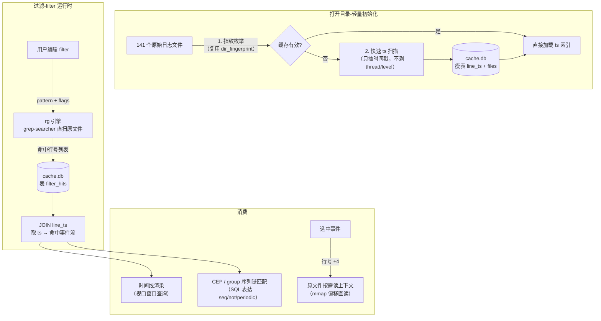

# v2 架构设计：rg 直扫 + SQL 只存 filter 结果

> 状态：**待确认**（本文档是设计稿，确认后实施）
> 日期：2026-09-30
> 背景：v1（SQL 存全量文本）实测失败——720MB 原始日志建库膨胀到 3GB+、建库数分钟、
> 扫描路径远慢于 rg（1 秒）。用户裁决：**SQL 存全量是本末倒置**。
> rg 实测基准：`rg -o "pengtest frame|pengtest vk" <目录>` 720MB 约 1 秒。

## 1. 核心思想

**原始文件就是数据库**（rg 直扫，零预处理零冗余）；**SQL 只存衍生数据**（filter 命中结果，
供 CEP/序列匹配/渲染查询）。回到用户最初的设想：SQL 是为 CEP 服务的查询层，不是文本仓库。



## 2. 数据流与存储

### 2.1 原始文件（唯一真源）
- 不做任何全量转换。文件枚举 + 指纹（rel+size+mtime FNV）沿用 [db.rs](../src-tauri/src/db.rs) 现有实现
- 搜索 = `grep-searcher` crate（rg 内核：mmap + SIMD + memchr），多文件可并行
- 上下文 = 按行号直接 mmap 读原文件片段

### 2.2 ts 索引（瘦表，方案 A）
打开目录时一次性扫描（**只提取时间戳，不剥 thread/level/message**）：

```sql
CREATE TABLE files (
  fid       INTEGER PRIMARY KEY,
  name      TEXT NOT NULL UNIQUE,   -- 相对路径
  first_line INTEGER NOT NULL       -- 该文件首行的全局行号
);
CREATE TABLE line_ts (              -- 瘦表：~16B/事件行
  line INTEGER PRIMARY KEY,         -- 全局行号
  ts   INTEGER NOT NULL             -- epoch ms（无时间戳的行不入表）
);
CREATE INDEX idx_line_ts_ts ON line_ts(ts, line);
```

- 720MB ≈ 500 万事件行 → **~80MB 表**（vs v1 的 3GB，缩小 37 倍）
- 扫描成本：时间戳正则 + int 解析 ≈ rg 级速度，预计 **2~5 秒一次性**
- 进度事件：`ts_scan_progress`（逐文件）
- 缓存：指纹不变直接复用；注意 ts 扫描依赖与 v1 相同的行切分语义（`split('\n')` 剥 `\r`）

### 2.3 filter 命中结果（核心新表）
每次 filter 运行（新增/编辑/启用）后写入：

```sql
CREATE TABLE filter_hits (
  filter_id TEXT NOT NULL,          -- 前端 filter id（f{ts}_{seq}）
  line      INTEGER NOT NULL,       -- 全局行号
  PRIMARY KEY (filter_id, line)
) WITHOUT ROWID;
CREATE INDEX idx_hits_line ON filter_hits(line);
```

- 大小：一条命中 ≈ 20B。1 万命中 = 200KB；**命中百万级也才 20MB**
- filter 编辑 = `DELETE FROM filter_hits WHERE filter_id=?` + 重扫重插（事务）
- **绝不存文本**——文本永远从原文件按需读

### 2.4 CEP / 序列匹配（SQL 本位，用户初始动机）
group 序列链（现有 [SequenceMatcher.ts](../src/sequence/SequenceMatcher.ts) 的图语义）下推 SQL：

```sql
-- 例：seq 边 A→B（窗口 maxGapMs）的链推进
WITH a AS (SELECT line, ts FROM filter_hits h JOIN line_ts t USING(line)
           WHERE h.filter_id = :filterA),
     b AS (SELECT line, ts FROM filter_hits h JOIN line_ts t USING(line)
           WHERE h.filter_id = :filterB)
SELECT a.line, b.line, b.ts - a.ts AS gap
FROM a JOIN b ON b.ts > a.ts AND b.ts <= a.ts + :maxGap
ORDER BY a.ts, b.ts;
```

- seq/not/and/or/periodic 全部可用 SQL 表达（窗口 join + NOT EXISTS + 分组断言）
- v1 迁移期：前端 SequenceMatcher 保留（小数据/浏览器模式），SQL 版做大数据加速路径

## 3. 运行时行为

| 操作 | v2 路径 | 预期耗时（720MB） |
|------|---------|------------------|
| 打开目录（首次） | 指纹 + ts 扫描建瘦表 | 2~5 秒（带进度） |
| 打开目录（二次） | 指纹命中，挂库 + 读 files/line_ts 计数 | **<0.5 秒** |
| 新建/编辑 filter | rg 直扫（敏感/不敏感/regex 同速）+ 写 filter_hits | **~1 秒**（= rg 基准） |
| 时间线渲染 | filter_hits JOIN line_ts，视口 ts 窗口查询 | 毫秒级 |
| 选中事件详情 | 原文件 mmap 按行号读 ±4 行 | 毫秒级 |
| 序列链匹配 | SQL（上表） | 亚秒级 |

## 4. 代码迁移计划

### 4.1 Rust 侧
| 现有资产 | 处置 |
|---------|------|
| [db.rs](../src-tauri/src/db.rs) 文件枚举/指纹/walk_log_files | **保留复用** |
| db.rs SCHEMA（lines/events/FTS5 大表） | **删除**（替换为瘦表 schema） |
| db.rs db_open 重建流程 | **改造**：ts 扫描代替全量建库（复用 `extract_timestamp`，跳过 parse_rest_offsets） |
| db.rs db_filter | **重写**：调 raw_search（grep crate）→ 写 filter_hits → 返回 (line, ts)[] |
| db.rs db_context_lines / db_events_in_window | **重写**：数据源改原文件 mmap + line_ts JOIN |
| db.rs parse_rest_offsets / contains_ci / 正则缓存 | parse_rest_offsets **保留**（详情行懒解析 thread/level 用）；contains_ci **废弃**（grep 引擎接管） |
| 新增 raw_search.rs | grep-searcher 封装：`search_dir(pattern, flags) → Vec<(fid, local_line)>`，行号映射经 files.first_line |
| Cargo.toml | + grep-searcher / grep-regex；rusqlite 保留 |

### 4.2 前端
| 现有资产 | 处置 |
|---------|------|
| [dbStore.ts](../src/io/dbStore.ts) | 改造：db_open 参数不变；fetchEventIndex → 读 line_ts；runDbFilter → 新 db_filter（返回 (line,ts)[]） |
| logStore dbMode/setLogDb | **简化**：events 骨架改为「打开时只装 files 元数据」，filter 命中后按需组装；或保留现状（骨架 12B/行，500 万=60MB，可接受） |
| DetailPanel 异步上下文 | **保留**（数据源换 mmap 读） |
| FilterEngine TS 版 | **保留**（浏览器/普通模式主路径；dbMode 才下推） |
| SequenceMatcher TS 版 | **保留**（v1 兼容）；SQL 版列为后续迭代 |

### 4.3 实施顺序（3 个 PR）
1. **PR-1 瘦表改造**：新 schema + ts 扫描 + db_open 改造（删除大表逻辑）+ 保留指纹缓存
2. **PR-2 rg 引擎**：raw_search.rs + db_filter 重写（filter_hits 写入）+ 前端 dbStore 适配
3. **PR-3 按需取数**：db_context_lines/db_events_in_window 重写（mmap 源）+ 渲染层视口查询验证
   （可选 PR-4：CEP SQL 下推）

### 4.4 兼容与回退
- 浏览器模式（无 Tauri）：完全不受影响（JS 路径）
- Tauri 普通单文件加载：走 parse_log 原路径
- dbMode 仅在「目录全选加载」时启用（现有触发条件不变）
- **旧 cache.db 处置**：schema 版本号（meta.schemaVersion=2）不符 → 自动删库重建（用户无感）
- 失败回退：rg 扫描/db 操作任一失败 → 回退 v1 逐文件路径（现有降级链保留）

## 5. 风险与开放问题

| 风险 | 对策 |
|------|------|
| ts 扫描 2~5 秒仍嫌慢 | 首次进度条 + 二次免扫；后续可并行化（按文件分线程） |
| rg 对 CRLF/编码的处理与 JS split 语义差异 | grep-searcher 行号 = `\n` 计数，与 `split('\n')` 天然一致；`\r` 剥离在 ts 扫描与上下文读取时各自处理 |
| filter_hits 与原文件漂移（文件被外部修改） | 指纹在每次打开校验；运行期修改未覆盖（v1 同样限制，暂接受） |
| message scope 过滤（时间戳后正文） | rg 直扫整行（raw scope）；message scope 需行内偏移——首版用「命中后二次校验偏移区间」，或降级 SQLite 扫描（保留现路径） |
| LogStreamView（文本流视图） | dbMode 下仍强制时间线视图（v1 现状）；后续可按需流式读原文件支持 |

## 6. 与 v1 的量级对比

| 指标 | v1（SQL 存一切） | v2（rg + 瘦 SQL） |
|------|----------------|-------------------|
| 磁盘占用 | 3GB+3GB wal | ~80MB（line_ts）+ KB 级（filter_hits） |
| 首次打开 | 数分钟建库 | 2~5 秒 ts 扫描 |
| 二次打开 | 秒级 | <0.5 秒 |
| filter（不敏感子串） | 数秒~数十秒（慢路径） | **~1 秒（rg 同速）** |
| filter（敏感 ≥3 字符） | FTS 毫秒级 | ~1 秒（rg；如需毫秒可保留 FTS 作为可选加速层） |
| 内存驻留 | 前端 60MB 骨架 + Rust 3GB | 前端 60MB 骨架 + Rust ~100MB |
